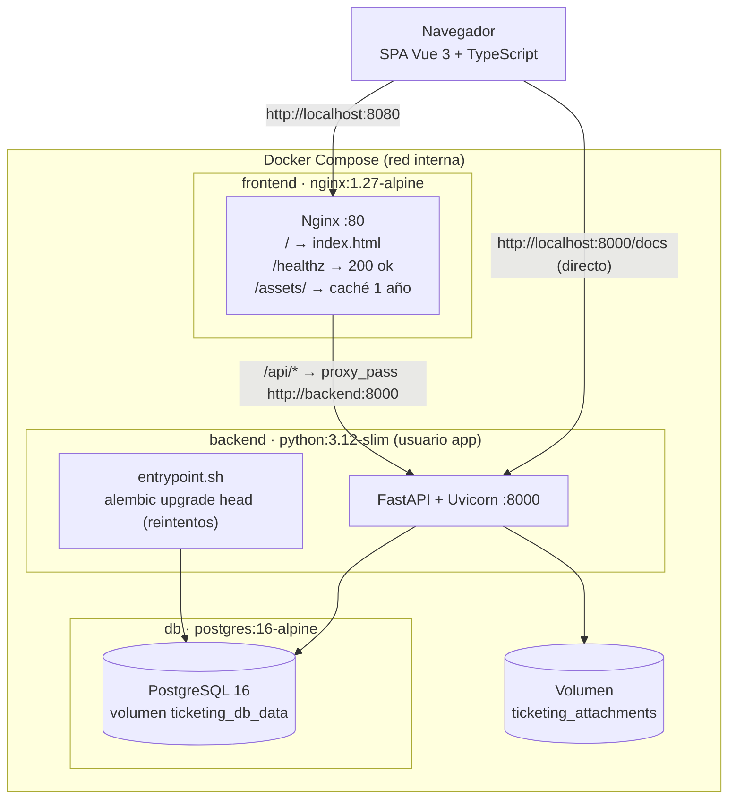
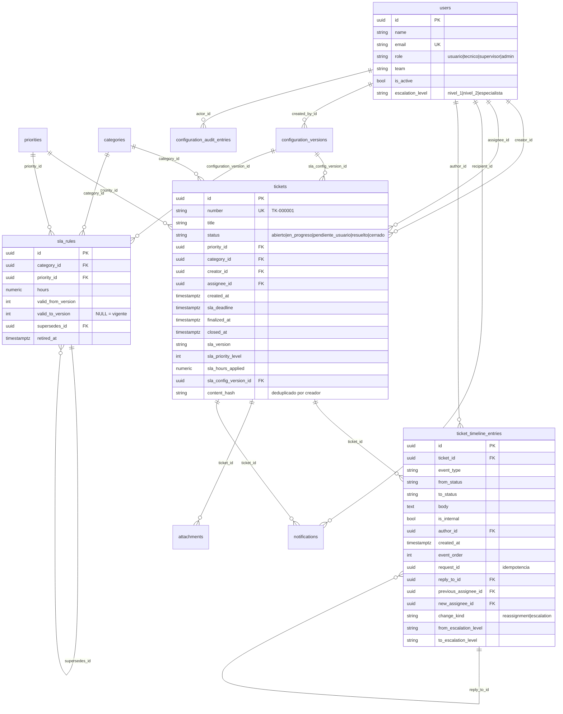
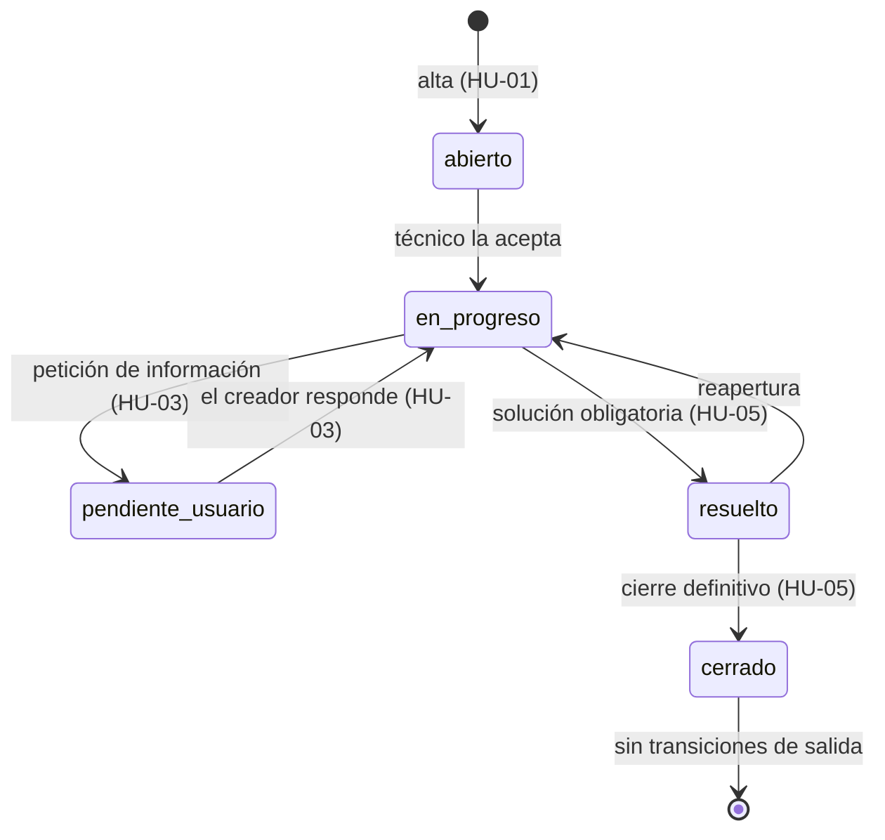
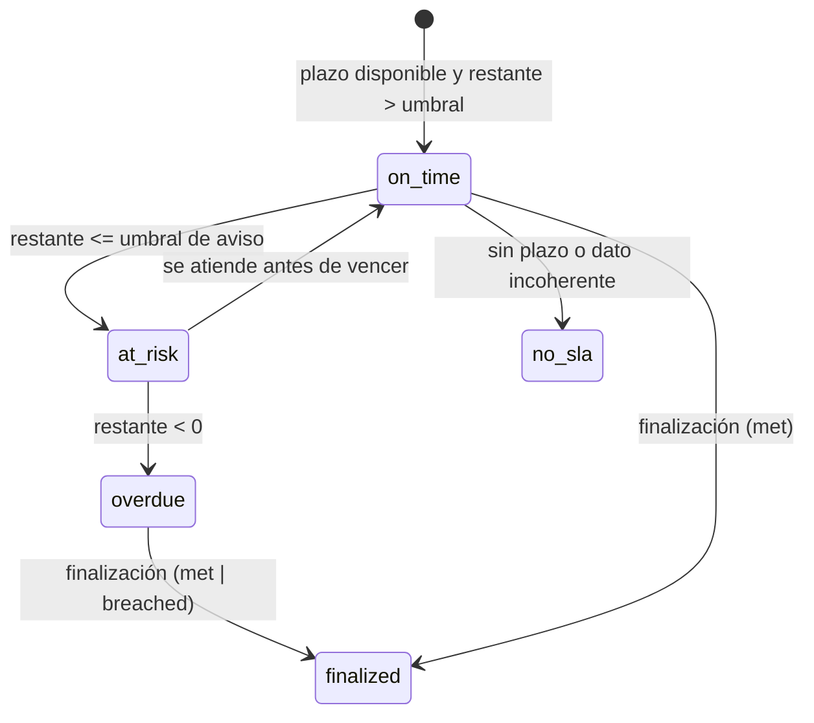

# Memoria técnica — Sistema de Mesa de Ayuda (Helpdesk Ticketing)

## Índice

1. [Portada y resumen](#1-portada-y-resumen)
2. [URL del repositorio en GitHub](#2-url-del-repositorio-en-github)
3. [Introducción](#3-introducción)
4. [Análisis](#4-análisis)
5. [Diseño](#5-diseño)
6. [Implementación](#6-implementación)
7. [Pruebas y validación](#7-pruebas-y-validación)
8. [Despliegue y uso](#8-despliegue-y-uso)
9. [Planificación y seguimiento](#9-planificación-y-seguimiento)
10. [Conclusiones](#10-conclusiones)
11. [Demo](#11-demo)
12. [Anexos](#12-anexos)

---

## 1. Portada y resumen

### 1.1 Metadatos del proyecto

Todos los datos de esta portada se han obtenido ejecutando `git log`, `git branch`, `git remote -v` y `git rev-list --count HEAD` sobre el repositorio real.

| Campo | Valor |
|---|---|
| **Título del proyecto** | Sistema de Mesa de Ayuda (Helpdesk Ticketing) |
| **Subtítulo** | Gestión de incidencias por tickets con cola de trabajo priorizada, cumplimiento de SLA y trazabilidad inmutable |
| **Autores (identidades de Git)** | Nayara `<nnr6@alu.ua.es>` — 24 commits · José Miguel Sáez Castro `<jmsc22@usal.es>` / `<124054536+jmsc22-ua@users.noreply.github.com>` / `jmsc22-ua` — 14 commits |
| **Rama activa** | `master` (rama por defecto del repositorio remoto) |
| **Primer commit** | `aad3cf8` — 2026-10-23 20:00:32 +0200 — Nayara — *feat: inicializar proyecto Ticketing con especificación completa* |
| **Último commit (HEAD)** | `867d1edaf3ca449550332bd8ea5bccf3d684f4e2` (corto `867d1ed`) |
| **Fecha del último commit** | 2026-11-19 20:53:23 +0100 |
| **Autor / mensaje del último commit** | Nayara — *Merge demo-video: vídeo y reproductor de todas las historias* |
| **Total de commits** | 38 (18 de contenido + 20 *merges*) |
| **Ventana temporal** | 2026-10-23 → 2026-11-19 (28 días) |
| **Repositorio remoto** | `origin` → `https://github.com/nnr6-ua/Ticketing.git` |

### 1.2 Resumen ejecutivo

La mesa de ayuda es una aplicación web interna que cubre el ciclo de vida completo de una incidencia: **creación → clasificación → cola de trabajo → respuesta al solicitante → resolución → cierre → reporte de cumplimiento**. El sistema se ha construido como un monorepo con backend `FastAPI` y frontend `Vue 3`, orquestado con `docker compose`, y ha seguido un proceso de ingeniería dirigido por especificación mediante **GitHub Spec Kit**: cada una de las ocho historias de usuario dispone de su carpeta en `specs/` con especificación, plan, investigación, modelo de datos, desglose de tareas, contrato OpenAPI y checklist de calidad.

Los cinco problemas de negocio que resuelve son:

1. **Priorización de la cola de trabajo**: el técnico no elige a ojo; el sistema ordena por prioridad y proximidad al vencimiento del SLA.
2. **Cumplimiento de SLA medible**: el supervisor dispone de un dashboard agregado con matriz de cumplimiento, totales y ranking de técnicos con semáforo.
3. **Versionado histórico de plazos**: los cambios de configuración no son retroactivos; cada ticket conserva la versión de configuración vigente en su creación.
4. **Control de acceso por rol**: identidad extraída exclusivamente del JWT y autorización siempre aplicada en servidor.
5. **Despliegue reproducible**: `docker compose up --build` levanta base de datos, API, migraciones y SPA sin pasos manuales.

### 1.3 Roles del sistema

Roles definidos en `backend/app/models/enums.py::UserRole` (enumeración `str`, usada como columna `Enum` en PostgreSQL):

| Rol (valor) | Etiqueta | Rutas de entrada | Funciones principales |
|---|---|---|---|
| `usuario` | Usuario / Empleado | `/mis-tickets` | Crear tickets, consultar estado e historial, responder peticiones de información |
| `tecnico` | Técnico | `/cola-de-trabajo`, `/tickets/:id` | Cola priorizada, transiciones de estado, resolución, comentarios internos, reasignar/escalar |
| `supervisor` | Supervisor | `/cola-de-trabajo`, `/dashboard-sla` | Dashboard de cumplimiento de SLA, identificación de retrasos |
| `admin` | Administrador | `/admin/configuracion`, `/dashboard-sla` | CRUD de categorías y prioridades, matriz SLA, histórico de configuración |

### 1.4 Stack tecnológico real

| Capa | Tecnología | Versión real declarada |
|---|---|---|
| API HTTP | FastAPI | `0.115.6` (`backend/requirements.txt`) |
| Servidor ASGI | Uvicorn `[standard]` | `0.32.1` |
| ORM | SQLAlchemy (síncrono) | `2.0.36` |
| Driver PostgreSQL | `psycopg[binary]` | `3.2.3` |
| Migraciones | Alembic | `1.14.0` |
| Validación | Pydantic / pydantic-settings | `2.10.4` / `2.7.0` |
| Autenticación | PyJWT | `2.10.1` |
| Base de datos | PostgreSQL (imagen `postgres:16-alpine`) | 16 |
| Frontend | Vue | `^3.5.13` |
| Lenguaje | TypeScript | `~5.7.2` |
| Compilador / dev server | Vite (`vite --version` en este entorno) | `6.4.5` |
| Gestión de estado | Pinia | `^2.3.0` |
| Enrutador | Vue Router | `^4.5.0` |
| Estilos | Tailwind CSS | `^3.4.17` |
| Iconografía | `lucide-vue-next`, `@heroicons/vue`, `@headlessui/vue` | `^0.468.0`, `^2.2.0`, `^1.7.23` |
| Contenedores | Docker / Docker Compose (entorno de ejecución) | `29.8.0` / `v5.5.1` |
| Servidor estático y proxy | Nginx (imagen `nginx:1.27-alpine`) | 1.27 |
| Pruebas backend | pytest + httpx + jsonschema + PyYAML | `pytest 8.3.4`, `httpx 0.28.1` |
| Pruebas frontend | Vitest + Vue Test Utils + jsdom + axe-core | `vitest 2.1.9` |

### 1.5 Recuento real de pruebas

Ejecutadas el 2026-11-19 en el entorno de desarrollo (Windows, Python 3.12.14, Node v24.21.0), sin modificar ningún fichero de código.

| Suite | Comando | Recogidas | Aprobadas | Omitidas | Fallidas | Duración |
|---|---|---:|---:|---:|---:|---:|
| Backend (ejecución 1) | `pytest -q --tb=short` | 622 | 598 | 22 | 2 | 419,30 s |
| Backend (ejecución 2) | `pytest -q --tb=no -rs` | 622 | 599 | 22 | 1 | 383,64 s |
| Backend (verificación final 2026-11-21, Linux) | `pytest -q --tb=short` | 622 | 599 | 22 | 1 | 229,15 s |
| Frontend | `npm test` (`vitest run`) | 55 ficheros | **395** | 0 | 0 | 18,00 s |
| Frontend (verificación final 2026-11-21) | `npm run build` + `npm test` | 55 ficheros | **395** | 0 | 0 | 13,88 s |

- Las **22 pruebas omitidas** están marcadas con `@pytest.mark.postgres` y requieren `TEST_DATABASE_URL` apuntando a un PostgreSQL 16 real (concurrencia con `with_for_update` y rendimiento real); sobre SQLite se saltran automáticamente.
- Los **fallos y la verificación final** están analizados con detalle en la [sección 7](#7-pruebas-y-validación); el fallo histórico de rendimiento del dashboard quedó resuelto y el único fallo de la verificación final es un p95 sensible a la carga de la suite que pasa aislado.
- Para poder ejecutar las suites fue necesario instalar localmente las dependencias que faltaban en el entorno (`python-multipart` en el `.venv` y `@headlessui/vue`/`@heroicons/vue` en `node_modules`); no se modificó ningún fichero versionado (`git status --porcelain` limpio).

---

## 2. URL del repositorio en GitHub

| Campo | Valor |
|---|---|
| URL | **https://github.com/nnr6-ua/Ticketing** |
| URL SSH/HTTPS de `origin` | `https://github.com/nnr6-ua/Ticketing.git` |
| Rama por defecto | `master` |
| Fecha de creación (API de GitHub) | 2026-10-22T10:14:01Z |
| Último empuje (`pushed_at`) | 2026-11-19T19:54:48Z |
| Lenguaje detectado | Python |
| Licencia | Sin licencia detectada por la API de GitHub |
| Pull Requests | 4 creados, 4 fusionados (0 abiertos) |

Ramas publicadas en el remoto: `master`, `hu-01-crear-ticket`, `hu-02-consultar-estado`, `hu-03-responder-tecnico`, `hu-04-cola-trabajo`, `hu-05-cambiar-estado`, `hu-06-reasignar-escalar`, `hu-07-dashboard-sla`, `hu-08-configuracion-sla`.

---

## 3. Introducción

### 3.1 Contexto del problema

Una mesa de ayuda interna resuelve incidencias informáticas y de servicios de la organización. Sin una herramienta, la gestión decae en cuatro síntomas observables: los tickets llegan por canales no trazables (correo, mensajería), nadie sabe qué incidencia debe atenderse primero, los compromisos de tiempo de respuesta (SLA) se incumplen sin que nadie lo detecte a tiempo y, cuando se detecta, no hay evidencia de quién hizo qué y cuándo. El resultado es retrabajo, pérdida de información y conflictos por la atribución de los retrasos.

### 3.2 Problemas que resuelve

| Problema | Solución implementada | Requisitos asociados |
|---|---|---|
| No se sabe qué atender primero | Cola de trabajo personal priorizada: activos antes que finalizados, orden por nivel de urgencia y `sla_deadline` ascendente | HU-04, RF-04 |
| Se incumplen plazos sin detectarlo | Clasificación en vivo de SLA (`dentro de plazo` / `próximo a vencer` / `vencido`) y dashboard agregado con semáforo | HU-07, RF-06 |
| Los plazos se cambian y arrastran tickets cerrados | Versionado de configuración (`configuration_versions`, `sla_rules` con `valid_from_version` / `valid_to_version`) y captura del plazo en el propio ticket | HU-08, RF-07 |
| Cualquiera puede mirar o hacer cualquier cosa | Identidad exclusivamente desde JWT y autorización en servidor por rol y por asignación actual | RF-03, RNF-07/08 |
| El despliegue depende de la máquina de cada persona | Imagen multi-etapa + `docker compose` con healthchecks, volumen de datos y migraciones automáticas | RNF-09 … RNF-13 |
| No hay evidencia de los cambios | Línea temporal *append-only* con autor, fecha, estado anterior/nuevo y motivo | RF-01.5, RF-03.5 |

### 3.3 Objetivos

1. Automatizar el alta, clasificación y asignación de incidencias con sugerencia de categoría y prioridad.
2. Garantizar que el técnico atienda primero lo más crítico mediante una cola ordenada y con indicadores de riesgo.
3. Hacer medible y visible el cumplimiento de SLA por prioridad, categoría y técnico.
4. Preservar la integridad histórica: nada de lo ocurrido se reescribe (línea temporal inmutable, configuración no retroactiva).
5. Asegurar mínimo privilegio, trazabilidad y mensajes íntegramente en español de España.
6. Entregar un sistema reproducible: un único comando de arranque y ninguna dependencia de herramientas locales.

### 3.4 Principios de la constitución

Fuente: [`.specify/memory/constitution.md`](../.specify/memory/constitution.md) — *fuente única de verdad*; `CONSTITUTION.md` (raíz) son resúmenes informativos. **Versión 1.0.0, ratificada y última enmienda: 2026-11-02.**

| # | Principio | Contenido esencial |
|---|---|---|
| I | Arquitectura por capas y stack fijado | Backend FastAPI + SQLAlchemy 2 + Alembic + PostgreSQL; frontend Vue 3 + TypeScript + Vite + Pinia + Tailwind. Dirección `api → services → models/db`; los endpoints solo orquestan. Prohibido añadir tecnologías, colas o servicios externos sin enmienda. |
| II | Modelo de datos estable y migraciones aditivas | Cambios de esqueleto solo aditivos y compatibles hacia atrás; migración Alembic con `upgrade()`/`downgrade()` verificables. El histórico de negocio es **append-only e inmutable**. |
| III | Seguridad y mínimo privilegio | Identidad exclusivamente del JWT (`Authorization: Bearer`); autorización siempre en servidor; datos internos jamás se envían a quien no puede verlos; secretos solo por variables de entorno; prohibido `v-html` con contenido de usuario. |
| IV | Contratos primero y pruebas verificables (**NO NEGOCIABLE**) | Contratos OpenAPI y de componentes antes de implementar; pruebas ejecutables de matriz de estados, permisos, visibilidad, atomicidad, concurrencia, idempotencia y códigos de error. Concurrencia real sobre PostgreSQL. Sin verificación ejecutable no hay terminación. |
| V | Simplicidad, trazabilidad y experiencia en español | YAGNI; la línea temporal es la fuente de trazabilidad; interfaz y mensajes en es-ES, fechas mostradas en `Europe/Madrid` y almacenadas en UTC; WCAG 2.1 AA y responsive. |

**Restricciones adicionales**: PostgreSQL en desarrollo y producción (SQLite solo en pruebas); formato de error `{"detail": {"code": "...", "message": "..."}}` con códigos estables en `snake_case`; compatibilidad con clientes que solo exponen GET/POST (comandos modelados como recursos POST); **rendimiento p95 < 300 ms de servidor** en lecturas y comandos, con historial paginado; contraste AA, foco visible, `role="alert"`/`aria-live` y navegación por teclado.

**Puertas de calidad**: especificación → plan → tareas antes de implementar; *Constitution Check* antes de la Fase 0 y tras la Fase 1; análisis de consistencia de solo lectura; antes de fusionar, suites en verde, migraciones `upgrade`/`downgrade` verificadas, revisión de accesibilidad y revisión de visibilidad de datos internos.

---

## 4. Análisis

### 4.1 Actores y roles

| Actor | Rol técnico | Autenticación | Permisos de lectura | Permisos de escritura |
|---|---|---|---|---|
| Usuario/Empleado | `usuario` | JWT | Sus propios tickets y su línea temporal pública | Crear ticket, responder petición de información |
| Técnico | `tecnico` | JWT | Su cola (tickets asignados) y detalle de tickets operativos | Transiciones, resolución, comentarios internos, reasignar/escalar |
| Supervisor | `supervisor` | JWT | Cola + dashboard SLA global (solo lectura) | Ninguno sobre configuración ni sobre tickets |
| Administrador | `admin` | JWT | Todo, incluido catálogo inactivo e histórico de configuración | CRUD de categorías/prioridades, matriz SLA, retiro de reglas |

El usuario creador **nunca** ve los comentarios internos; un técnico no asignado tampoco (verificado en `backend/tests/integration/test_timeline_visibility.py`).

### 4.2 Historias de usuario (HU-01 … HU-08)

Extraídas de [`specs/000-helpdesk-ticketing/spec.md`](../specs/000-helpdesk-ticketing/spec.md).

| ID | Historia | Actor | Carpeta en `specs/` | Criterios de aceptación (resumen) |
|---|---|---|---|---|
| HU-01 | Crear ticket con sugerencia automática | Usuario | `001-crear-ticket` | Descripción libre; adjuntos de imagen; número de ticket único; sugerencia de categoría y prioridad por palabras clave; aceptar o modificar antes de confirmar |
| HU-02 | Consultar estado e historial del ticket | Usuario | `002-ticket-timeline-history` | Estado actual visible; línea temporal cronológica; comentarios del técnico; fecha, hora, autor y tipo de cambio por entrada |
| HU-03 | Responder a petición de información del técnico | Usuario | `003-responder-peticion-tecnico` | Técnico marca «Pendiente de usuario»; notificación al usuario; respuesta desde el ticket; transición automática a «En progreso»; respuesta registrada |
| HU-04 | Ver cola de trabajo priorizada | Técnico | `004-prioritized-work-queue` | Solo sus tickets; número, resumen, categoría, prioridad y tiempo restante SLA; orden por prioridad y menor tiempo restante; destacado de próximos a incumplir; filtros por estado y prioridad |
| HU-05 | Cambiar estado y documentar resolución | Técnico | `005-cambio-estado-resolucion` | Transiciones entre estados definidos; descripción de solución obligatoria al pasar a «Resuelto»; solución visible en línea temporal; comentarios internos en cualquier momento |
| HU-06 | Reasignar o escalar ticket | Técnico | `006-reasignar-escalar-ticket` | Selector de técnico; escalado a nivel superior; notificación inmediata; registro con autor y motivo; el ticket pasa a la cola del nuevo responsable |
| HU-07 | Dashboard de cumplimiento de SLA | Supervisor | `007-dashboard-cumplimiento-sla` | Métricas por prioridad y categoría; % en plazo, tiempo medio y vencidos; ranking de técnicos; filtros por fechas/categoría/prioridad; semáforo verde/ámbar/rojo |
| HU-08 | Configuración de categorías, prioridades y plazos (SLA) | Administrador | `008-configuracion-plazos-sla` | CRUD de categorías y prioridades; matriz categoría × prioridad; sin retroactividad sobre tickets cerrados; desactivar (no borrar) lo está en uso |

### 4.3 Requisitos funcionales (RF-01 … RF-08)

| ID | Requisito | Subrequisitos | Historias |
|---|---|---|---|
| RF-01 | Gestión de tickets | .1 crear con descripción, adjuntos, categoría y prioridad · .2 número único secuencial · .3 sugerencia automática por palabras clave · .4 listado con filtros · .5 detalle con línea temporal completa | HU-01, HU-02 |
| RF-02 | Flujo de estados | .1 estados Abierto/En progreso/Pendiente de usuario/Resuelto/Cerrado · .2 transiciones válidas (sin «Cerrado → Abierto») · .3 cambio automático a «En progreso» al responder · .4 solución obligatoria al resolver | HU-03, HU-05 |
| RF-03 | Asignación y escalado | .1 asignar manual o por categoría · .2 reasignar en el mismo nivel · .3 escalar a nivel superior · .4 notificación inmediata · .5 registro de cada cambio de responsable | HU-06 |
| RF-04 | Cola de trabajo del técnico | .1 vista con sus tickets · .2 orden prioridad desc + tiempo restante asc · .3 indicador de urgencia · .4 filtros por estado y prioridad | HU-04 |
| RF-05 | Adjuntos | .1 subida de imágenes PNG/JPG/GIF · .2 límite por archivo y por ticket · .3 visualización inline | HU-01 |
| RF-06 | Dashboard de supervisión | .1 métricas por prioridad y categoría · .2 % cumplimiento, tiempo medio y vencidos · .3 ranking de técnicos · .4 filtros temporales y por dimensión · .5 semáforo con umbrales | HU-07 |
| RF-07 | Administración de catálogos y SLA | .1 CRUD categorías · .2 CRUD prioridades con nivel y plazo base · .3 matriz SLA categoría × prioridad · .4 versionado: el ticket guarda la configuración vigente al crearse · .5 desactivar, no borrar | HU-08 |
| RF-08 | Notificaciones | .1 notificación en app (campana) · .2 email opcional para eventos críticos · .3 preferencias por usuario | HU-06 (en app) |

### 4.4 Requisitos no funcionales (RNF-01 … RNF-13)

| ID | Requisito | Estado de cobertura |
|---|---|---|
| RNF-01 | Interfaz 100 % en español de España | Implementado; pruebas de etiquetas en español (`test_labels_are_spanish`) |
| RNF-02 | Moneda en euros (futuras extensiones) | Fuera de alcance v1 (no aplica) |
| RNF-03 | Accesibilidad WCAG 2.1 AA | Implementado; pruebas `axe-core` en `TicketAccessibility.spec.ts`, `WorkQueueAccessibility.spec.ts`, `SlaDashboardAccessibility.spec.ts` |
| RNF-04 | Responsive (desktop y tablet) | Implementado con Tailwind |
| RNF-05 | Carga de vistas < 2 s | Verificado en el recorrido manual (sección 7.4) |
| RNF-06 | Disponibilidad 99,5 % en horario laboral | Objetivo de operación; sin SLA de infraestructura en el proyecto |
| RNF-07 | Sin claves ni secretos en código | `.env.example` sin secretos reales; `.env` ignorado por Git; secretos vía pydantic-settings |
| RNF-08 | Solo datos imprescindibles del usuario | `User` = nombre, email, rol, equipo, nivel de escalado, activo |
| RNF-09 | Despliegue reproducible con Docker Compose (`docker compose up` sin pasos previos) | Implementado y verificado (sección 8) |
| RNF-10 | Persistencia de PostgreSQL en volumen nombrado; `docker compose down` no borra datos | Volumen `ticketing_db_data` en `docker-compose.yml` |
| RNF-11 | Toda configuración sensible por variables de entorno; solo `.env.example` en el repositorio | Verificado en `.env.example` y `app/core/config.py` |
| RNF-12 | Imágenes multi-etapa, backend con usuario sin privilegios y healthchecks | `Dockerfile` multi-etapa, `USER app`, healthchecks de `db`, `backend` y `frontend` |
| RNF-13 | Migraciones Alembic automáticas con reintentos al arrancar | `backend/docker/entrypoint.sh` con `MIGRATION_MAX_ATTEMPTS`/`MIGRATION_RETRY_SECONDS` |

### 4.5 Reglas de negocio clave

**Cálculo de plazos SLA.** El plazo aplicable se resuelve con `resolve_sla()` (`backend/app/services/sla_resolution.py`): si existe una regla vigente para la combinación categoría × prioridad se usa su `hours`; en caso contrario se usa el `base_hours` de la prioridad. El resultado (`ResolvedSla`) fija `hours`, `priority_level`, `source` (`"rule"` o `"priority_base"`) y `config_version_id`, y se persiste **en el ticket** (`sla_hours_applied`, `sla_priority_level`, `sla_version`, `sla_config_version_id`), de modo que un cambio posterior de configuración no altera tickets existentes.

```python
hours = current_rule.hours if current_rule is not None else priority.base_hours
if hours is None or hours <= 0:
    raise ApiError(
        500,
        "configuration_not_configured",
        "No hay un plazo SLA válido para la combinación seleccionada.",
    )
return ResolvedSla(
    hours=Decimal(hours).quantize(Decimal("0.01")),
    priority_level=priority.level,
    source="rule" if current_rule is not None else "priority_base",
    rule_id=current_rule.id if current_rule is not None else None,
    config_version_id=config_version.id,
)
```

**Semáforo de cumplimiento.** Umbrales de negocio versionados en código (`backend/app/utils/sla.py`):

```python
# Umbrales del semáforo del dashboard de cumplimiento (HU-07).
# Son constantes de negocio versionadas en código, no configuración de entorno.
# El valor exacto de un umbral pertenece siempre a la banda superior.
SLA_GREEN_THRESHOLD_PCT = 90.0  # verde: cumplimiento >= 90 %
SLA_AMBER_THRESHOLD_PCT = 70.0  # ámbar: 70 % <= cumplimiento < 90 %
# rojo: cumplimiento < 70 %
```

```python
def compliance_band(pct: Decimal | float | None) -> str:
    if pct is None:
        return "sin_datos"
    value = float(pct)
    if value >= SLA_GREEN_THRESHOLD_PCT:
        return "verde"
    if value >= SLA_AMBER_THRESHOLD_PCT:
        return "ambar"
    return "rojo"
```

**Estado de riesgo en vivo** (`classify_sla`): ticket finalizado → `finalized`; sin plazo o sin inicio → `no_sla`; plazo vencido → `overdue`; restante ≤ umbral de aviso → `at_risk`; resto → `on_time`. El umbral de aviso es la **mitad** del total si el SLA dura menos de 60 minutos y el **25 %** en caso contrario (mínimo 1 hora).

**Resultado histórico** (`sla_outcome`): `met` si `finalized_at <= deadline`, `breached` en caso contrario, `no_sla` si falta cualquiera de los dos. Un límite exacto se considera **dentro de plazo**.

**Transiciones de estado.** Matriz total en `backend/app/services/ticket_state_machine.py`:

| Estado actual | Destinos permitidos |
|---|---|
| `abierto` | `en_progreso` |
| `en_progreso` | `pendiente_usuario`, `resuelto` |
| `pendiente_usuario` | `en_progreso` |
| `resuelto` | `en_progreso`, `cerrado` |
| `cerrado` | *(ninguno: cierre definitivo)* |

### 4.6 Reglas que cruzan historias

| Regla | Historias implicadas | Descripción |
|---|---|---|
| La respuesta a «Pendiente de usuario» la detecta HU-03 y la transición la valida HU-05 | HU-03 ↔ HU-05 | HU-03 procesa la respuesta del creador; HU-05 debe aceptar `pendiente_usuario → en_progreso` y registrarla (HU05-RF-027 … RF-033) |
| La cola refleja al instante los cambios de HU-06 | HU-06 ↔ HU-04 | Tras reasignar/escalar, el ticket aparece en la cola del nuevo responsable y desaparece de la anterior en la siguiente actualización |
| La cola refleja los cambios de estado de HU-05 | HU-05 ↔ HU-04 | Los finalizados pasan al final de la lista con su resultado histórico de SLA, sin cuenta atrás en vivo |
| El SLA capturado en HU-01/08 gobierna la cola de HU-04 | HU-01, HU-08 ↔ HU-04 | `sla_deadline` y `sla_priority_level` fijados al crearse son los que ordenan y clasifican la cola |
| El dashboard de HU-07 lee el histórico escrito por HU-04/05/06 | HU-04/05/06 ↔ HU-07 | Cálculo de primera finalización, vencidos y atribución de responsables sin escribir nunca en la línea temporal |
| La configuración de HU-08 no altera tickets ya creados | HU-08 ↔ HU-01/07 | No retroactividad verificada en `test_sla_non_retroactivity.py` |
| Autorización transversal | Todas | La defensa real es del backend (`403 forbidden`); los guards del router son cosméticos |

---

## 5. Diseño

### 5.1 Estructura del monorepo

```text
Ticketing/
├── .specify/                      # GitHub Spec Kit: constitución, scripts, plantillas, workflows
│   ├── memory/constitution.md     # Fuente única de verdad de la constitución
│   ├── scripts/bash/              # create-new-feature, setup-plan, setup-tasks, check-prerequisites
│   ├── templates/                 # spec, plan, tasks, checklist, constitution
│   └── workflows/speckit/workflow.yml
├── specs/                         # 9 carpetas de especificación (71 ficheros)
│   ├── 000-helpdesk-ticketing/    # Especificación raíz + checklist
│   └── 001-…008-…/                # spec.md, plan.md, tasks.md, research.md,
│                                  # data-model.md, quickstart.md, checklists/, contracts/
├── backend/
│   ├── alembic/versions/          # 11 migraciones (incluidas 2 de fusión)
│   ├── app/
│   │   ├── api/                   # deps.py (JWT/autorización) + v1/ (8 routers)
│   │   ├── core/                  # config.py (entorno), errors.py (formato de error)
│   │   ├── db/                    # base.py, session.py
│   │   ├── models/                # 8 modelos + enums.py
│   │   ├── schemas/               # contratos Pydantic de entrada/salida
│   │   ├── services/              # lógica de negocio (15 módulos)
│   │   └── utils/sla.py           # cálculo canónico de SLA (funciones puras)
│   ├── docker/entrypoint.sh       # migraciones con reintentos + uvicorn
│   ├── scripts/                   # seed_dev.py, seed_hu02_demo.py
│   └── tests/                     # unit/ (13), contract/ (9), integration/ (38)
├── frontend/
│   ├── public/demo/               # reproductor de la demo (index.html + vídeo)
│   ├── nginx.conf                 # SPA + proxy inverso /api
│   ├── src/                       # api, auth, components, composables, router,
│   │                              # services, stores, types, utils, views
│   └── tests/                     # unit/ components/ stores/ views/ (55 specs)
├── docker-compose.yml             # servicios db, backend, frontend + volúmenes
├── Dockerfile                     # imagen multi-etapa con destinos `backend` y `frontend`
├── .env.example                   # variables de entorno documentadas (sin secretos)
├── CONSTITUTION.md                # resumen informativo (prevalece .specify/memory/)
└── README.md                      # arranque, variables y pruebas
```

### 5.2 Arquitectura de servicios



Puntos de diseño relevantes:

- **Un único origen para el cliente**: la SPA usa rutas relativas `/api/...` y Nginx proxifica al servicio `backend`, de modo que no hay problemas de CORS ni de mezcla de orígenes en el despliegue por defecto (`VITE_API_BASE_URL` vacío).
- **CORS explícito** para el desarrollo con Vite en otro puerto (`FRONTEND_ORIGINS`), restringido a `GET` y `POST` y con `expose_headers=["Cache-Control", "Vary"]`.
- **Healthchecks encadenados**: `db` (`pg_isready`) → `backend` (`/openapi.json`) → `frontend` (`/healthz`), de forma que Compose no arranca un servicio antes de que su dependencia esté operativa.

### 5.3 Modelo entidad-relación

Basado en los ficheros reales de `backend/app/models/`.



### 5.4 Restricciones de integridad y migraciones

Las reglas de negocio se refuerzan en la propia base de datos mediante `CheckConstraint` (constitución II: la integridad no depende solo de la aplicación):

| Tabla | Restricción | Regla que protege |
|---|---|---|
| `tickets` | `ck_tickets_finalized_at` | `finalized_at` solo existe en estados finales y es `NULL` en los activos |
| `tickets` | `ck_tickets_finalized_after_created` | `finalized_at >= created_at` |
| `tickets` | `ck_tickets_sla_deadline_after_created` | `sla_deadline > created_at` |
| `tickets` | `ck_tickets_sla_priority_level` | Nivel SLA entre 1 y 4 |
| `tickets` | `ck_tickets_sla_hours_positive` | Plazo SLA positivo |
| `tickets` | `uq_tickets_creator_content_hash` | Duplicados: mismo creador + mismo contenido |
| `ticket_timeline_entries` | `ck_timeline_status_change` / `_resolution` / `_internal_comment` / `_information_request` / `_user_response` / `_assignee_change` | Cada tipo de evento exige exactamente los campos que le corresponden (y prohíbe los ajenos) |
| `ticket_timeline_entries` | `ck_timeline_assignee_change` | Un cambio de responsable exige origen y destino distintos y coherencia entre `change_kind` y los niveles de escalado |
| `ticket_timeline_entries` | `ck_timeline_body_length` | Cuerpo entre 1 y 5.000 caracteres |
| `ticket_timeline_entries` | `uq_timeline_request_event` | Idempotencia: `ticket_id + request_id + event_type` |
| `sla_rules` | `uq_sla_rules_current_combination` (índice único parcial con `valid_to_version IS NULL`) | **Solo puede haber una regla vigente por combinación categoría × prioridad** |
| `sla_rules` | `ck_sla_rules_valid_range`, `ck_sla_rules_hours_positive` | Rangos de versiones coherentes y plazos positivos |
| `configuration_versions` | `uq_configuration_versions_version` | Numeración de versiones estrictamente creciente |

**Migraciones Alembic** (11 ficheros en `backend/alembic/versions/`):

| Revisión | Archivo | `down_revision` | Origen |
|---|---|---|---|
| `0001_base_schema` | `0001_base_schema.py` | — | Esquema inicial |
| `0002_work_queue` | `0002_add_finalized_at_and_work_queue_indexes.py` | `0001` | HU-04 |
| `0003_ticket_timeline` | `0003_ticket_timeline.py` | `0002` | HU-02/HU-05 |
| `0004_assignee_changes` | `0004_assignee_changes_notifications.py` | `0003` | HU-06 |
| `0004_ticket_creation` | `0004_ticket_creation.py` | `0003` | HU-01 (rama paralela) |
| `0005_public_timeline_comments` | `0005_public_timeline_comments.py` | `0004_ticket_creation` | HU-02 (rama paralela) |
| `0005_ticket_information` | `0005_ticket_information.py` | `0004_ticket_creation` | HU-03 |
| `0006_sla_configuration` | `0006_sla_configuration.py` | `0005_ticket_information` | HU-08 |
| `0007_merge_hu06_hu08` | `0007_merge_hu06_hu08.py` | `0004_assignee_changes`, `0006_sla_configuration` | **Fusión de ramas** |
| `0008_sync_ticket_number_sequence` | `0008_sync_ticket_number_sequence.py` | `0007` | Sincronización de secuencia |
| `0009_merge_public_comments` | `0009_merge_public_comments.py` | `0008`, `0005_public_timeline_comments` | **Fusión de ramas** |

Las dos migraciones de tipo `merge` son la evidencia de que las ramas HU-06/HU-08 y HU-02/HU-03 avanzaron en paralelo sobre el mismo esquema y hubo que reconciliar líneas de descendencia divergentes (ver sección 10).

### 5.5 Máquinas de estado del ticket



Complementaria, la máquina de riesgo de SLA sobre el estado del ticket:



### 5.6 Tabla de endpoints REST

Rutas reales extraídas de `app.main.app` (`from app.main import app` + recorrido de `app.routes`). Prefijo global `/api/v1`.

| Método | Ruta | Módulo | Descripción | Autorización |
|---|---|---|---|---|
| POST | `/dev/login` | `dev_auth` | Emite JWT para un usuario del seed (solo si `AUTH_DEV_STUB_ENABLED=true`) | Stub de desarrollo |
| GET | `/priorities` | `ticket_creation` | Prioridades activas para el formulario | Autenticado |
| POST | `/suggestions` | `ticket_creation` | Sugiere categoría y prioridad desde el texto | Autenticado |
| POST | `/tickets` | `ticket_creation` | Crea ticket con adjuntos | Autenticado (creador) |
| GET | `/me/tickets` | `my_tickets` | Tickets propios con paginación | Autenticado |
| GET | `/me/work-queue` | `work_queue` | Cola priorizada del técnico | `require_technician` |
| GET | `/tickets/{id}/workflow` | `tickets` | Estados permitidos, capacidades y versión | Creador / roles operativos |
| POST | `/tickets/{id}/status-transitions` | `tickets` | Transición de estado o resolución | Técnico asignado |
| POST | `/tickets/{id}/information-requests` | `tickets` | Petición de información (→ pendiente) | Técnico asignado |
| POST | `/tickets/{id}/information-responses` | `tickets` | Respuesta del creador (→ en progreso) | Creador |
| POST | `/tickets/{id}/internal-comments` | `tickets` | Comentario interno | Técnico asignado |
| GET | `/tickets/{id}/timeline` | `tickets` | Página de línea temporal visible para el rol | Según visibilidad |
| GET | `/tickets/{id}/assignee-change-options` | `tickets` | Candidatos y niveles disponibles | Técnico asignado |
| POST | `/tickets/{id}/reassignments` | `tickets` | Reasigna a otro técnico | Técnico asignado |
| POST | `/tickets/{id}/escalations` | `tickets` | Escala a nivel superior | Técnico asignado |
| GET | `/me/notifications` | `notifications` | Campana de notificaciones | Autenticado |
| POST | `/me/notifications/{id}/read` | `notifications` | Marca como leída | Autenticado |
| GET | `/sla-dashboard` | `sla_dashboard` | Snapshot agregado del dashboard | `require_supervisor_or_admin` |
| GET | `/sla-dashboard/options` | `sla_dashboard` | Opciones de filtro (categorías/prioridades) | `require_supervisor_or_admin` |
| GET | `/admin/categories` | `admin_configuration` | Catálogo completo (incluye inactivas) | `require_admin` |
| POST | `/admin/categories` | `admin_configuration` | Crea categoría | `require_admin` |
| POST | `/admin/categories/{id}/updates` | `admin_configuration` | Actualiza categoría (bloqueo optimista) | `require_admin` |
| POST | `/admin/categories/{id}/deletion` | `admin_configuration` | Elimina si no está en uso | `require_admin` |
| GET | `/admin/priorities` | `admin_configuration` | Catálogo de prioridades | `require_admin` |
| POST | `/admin/priorities` | `admin_configuration` | Crea prioridad | `require_admin` |
| POST | `/admin/priorities/{id}/updates` | `admin_configuration` | Actualiza prioridad | `require_admin` |
| POST | `/admin/priorities/{id}/deletion` | `admin_configuration` | Elimina si no está en uso | `require_admin` |
| GET | `/admin/sla-rules` | `admin_configuration` | Matriz SLA vigente | `require_admin` |
| POST | `/admin/sla-rules/batch` | `admin_configuration` | Aplica un lote de cambios de plazos (atómico) | `require_admin` |
| POST | `/admin/sla-rules/{id}/retirement` | `admin_configuration` | Retira una regla vigente | `require_admin` |
| GET | `/admin/config-history` | `admin_configuration` | Histórico de configuración | `require_admin` |

> **31 endpoints** en total (30 + el stub de desarrollo). Todos los comandos son `POST` —no `PATCH`/`PUT`/`DELETE`— por la restricción de compatibilidad de cliente de la constitución.

### 5.7 Decisiones técnicas clave

| Decisión | Alternativas descartadas | Motivo |
|---|---|---|
| Comandos modelados como recursos `POST` (`/updates`, `/deletion`, `/retirement`, `/status-transitions`) | `PATCH`/`PUT`/`DELETE` REST clásico | El cliente disponible solo expone GET y POST (restricción de la constitución) |
| Línea temporal *append-only* con `request_id` como clave de idempotencia | Tabla de historial editable / «last write wins» | Constitución II: la evidencia no se reescribe; evita duplicados ante reintentos y dobles envíos |
| Plazo SLA **capturado en el ticket** (`sla_hours_applied`, `sla_config_version_id`) | Recalcular el plazo en cada consulta desde la configuración vigente | Garantiza la no retroactividad (HU-08) y que el dashboard histórico no cambie |
| Reglas SLA con solapamiento de versiones (`valid_from_version` / `valid_to_version`) + índice único parcial | Sobrescribir la fila de la regla | Conserva el histórico y permite saber qué plazo estaba vigente en cada fecha |
| Autorización en servidor con dependencias FastAPI (`require_technician`, `require_supervisor_or_admin`, `require_admin`) | Ocultar botones en el frontend | Constitución III: el cliente no es la defensa |
| Cálculo de SLA en funciones puras y testeables (`app/utils/sla.py`) | Lógica de tiempo incrustada en endpoints | Testeable sin base de datos y sin ambigüedad de husos horarios (UTC internamente, `Europe/Madrid` solo en presentación) |
| Imagen Docker única con dos etapas destino (`backend`, `frontend`) | Dos repositorios/imágenes independientes | Despliegue reproducible con un `docker-compose.yml` y un solo `Dockerfile` |
| Nginx como proxy en el mismo origen | CORS ampliado + `VITE_API_BASE_URL` absoluto | Elimina problemas de orígenes en el despliegue por defecto |
| Sugerencias por palabras clave (sin ML) | Clasificador automático | Supuesto 2 de la especificación; YAGNI para v1 |
| Bloqueo optimista con `expected_updated_at` + `ConflictBanner` | Bloqueo pesimista en todas las lecturas | Evita pisar cambios concurrentes sin bloquear la cola |

---

## 6. Implementación

### 6.1 Pila tecnológica detallada

**`backend/requirements.txt`** (14 dependencias, todas con versión fijada):

```text
fastapi==0.115.6
uvicorn[standard]==0.32.1
SQLAlchemy==2.0.36
psycopg[binary]==3.2.3
alembic==1.14.0
pydantic==2.10.4
pydantic-settings==2.7.0
PyJWT==2.10.1
pytest==8.3.4
httpx==0.28.1
PyYAML==6.0.2
jsonschema==4.23.0
tzdata==2024.2
python-multipart==0.0.20
```

**`frontend/package.json`** (dependencias y *devDependencies* principales):

```json
"dependencies": {
  "@headlessui/vue": "^1.7.23",
  "@heroicons/vue": "^2.2.0",
  "lucide-vue-next": "^0.468.0",
  "pinia": "^2.3.0",
  "vue": "^3.5.13",
  "vue-router": "^4.5.0"
},
"devDependencies": {
  "@types/node": "^22.20.5",
  "@vitejs/plugin-vue": "^5.2.1",
  "@vue/test-utils": "^2.4.6",
  "axe-core": "^4.10.2",
  "jsdom": "^25.0.1",
  "tailwindcss": "^3.4.17",
  "typescript": "~5.7.2",
  "vite": "^6.0.5",
  "vitest": "^2.1.8",
  "vue-tsc": "^2.2.0"
}
```

Scripts: `dev`, `build` (`vue-tsc --noEmit && vite build`), `test` (`vitest run`), `test:unit`, `test:components`.

### 6.2 Métricas de código

Recuento con `Get-Content | Measure-Object -Line` sobre los directorios fuente (sin `node_modules`, sin `.venv`, sin `dist`):

| Métrica | Valor |
|---|---|
| Líneas Python en `backend/app` | 8.590 |
| Líneas Python en `backend/app + tests + alembic + scripts` | 26.241 |
| Ficheros Python en esos mismos directorios | 139 |
| Líneas TypeScript/Vue en `frontend/src + frontend/tests` | 19.873 |
| Ficheros `.ts`/`.vue` en esos mismos directorios | 151 |
| Módulos de servicio de negocio | 15 (`backend/app/services/`) |
| Modelos SQLAlchemy | 8 modelos + `enums.py` (9 ficheros en `backend/app/models/`) |
| Migraciones Alembic | 11 |
| Ficheros de especificación en `specs/` | 71 |
| Ficheros de prueba backend (sin auxiliares) | 60 (13 unit + 9 contract + 38 integration) |
| Ficheros de prueba frontend | 55 |

### 6.3 Módulos más relevantes

#### 6.3.1 Autenticación y autorización JWT — `backend/app/api/deps.py`

La identidad se resuelve **exclusivamente** del token Bearer; no se aceptan identificadores por *query string* ni cookies:

```python
def get_current_user(
    credentials: HTTPAuthorizationCredentials | None = Depends(bearer_scheme),
    session: Session = Depends(get_session),
) -> User:
    """Valida el Bearer JWT y devuelve el usuario autenticado."""

    if credentials is None or not credentials.credentials:
        raise _unauthorized()

    settings = get_settings()
    if not settings.jwt_secret:
        # Sin secreto configurado no se puede validar ningún token: nunca se
        # aceptan peticiones anónimas ni se usan secretos embebidos.
        raise _unauthorized()

    try:
        payload = jwt.decode(
            credentials.credentials,
            settings.jwt_secret,
            algorithms=[settings.jwt_algorithm],
            audience=settings.auth_audience or None,
            issuer=settings.auth_issuer or None,
            options={"require": ["exp", "sub"]},
        )
    except jwt.PyJWTError as exc:
        raise _unauthorized() from exc

    subject = payload.get("sub")
    try:
        user_id = UUID(str(subject))
    except (TypeError, ValueError) as exc:
        raise _unauthorized() from exc

    user = session.get(User, user_id)
    if user is None or not user.is_active:
        raise _unauthorized()
    return user
```

Guardas por rol (siempre en servidor, con mensajes en es-ES):

```python
def require_technician(current_user: User = Depends(get_current_user)) -> User:
    """Restringe la vista de la cola de trabajo al rol `tecnico`."""
    if current_user.role != UserRole.tecnico:
        raise ApiError(403, "forbidden", WORK_QUEUE_FORBIDDEN_MESSAGE)
    return current_user

def require_supervisor_or_admin(response, current_user = Depends(get_current_user)) -> User:
    response.headers["Cache-Control"] = "no-store"
    response.headers["Vary"] = "Authorization"
    if current_user.role not in (UserRole.supervisor, UserRole.admin):
        raise ApiError(403, "forbidden", SLA_DASHBOARD_FORBIDDEN_MESSAGE)
    return current_user
```

#### 6.3.2 Cálculo de SLA y cola de trabajo

El orden de la cola (`backend/app/services/work_queue.py::_ordered_statement`) es la regla de negocio central de la HU-04: primero los activos, después por urgencia, después por proximidad al vencimiento, y los finalizados al final ordenados por recencia:

```python
is_final = case((_finals_condition(), 1), else_=0)
urgency_level = func.coalesce(Ticket.sla_priority_level, Priority.level)

return statement.order_by(
    is_final.asc(),
    case((_finals_condition(), None), else_=urgency_level).asc().nulls_last(),
    case((_finals_condition(), None), else_=Ticket.sla_deadline).asc().nulls_last(),
    case((_finals_condition(), Ticket.finalized_at), else_=None).desc().nulls_last(),
    Ticket.number.asc(),
)
```

Notas de implementación:

- `sla_priority_level` es el nivel capturado al crearse; `coalesce` con `Priority.level` permite calcular la urgencia de los tickets «legacy» anteriores a la HU-08.
- `nulls_last()` evita que los tickets sin SLA se cuelen primero.
- `Ticket.number` es el desempate estable final, garantizando un orden reproducible entre peticiones.
- La visibilidad es **del propio SQL**: `_visible_to_technician_condition(user_id)` filtra por asignación actual, de modo que un técnico jamás recibe en la respuesta tickets de otros.

#### 6.3.3 Dashboard de cumplimiento de SLA — `backend/app/services/sla_dashboard.py`

Módulo de solo lectura (≈ 1.030 líneas) estructurado en capas puras y testeables:

| Función | Responsabilidad |
|---|---|
| `parse_filters` / `resolve_period` | Normaliza `desde`, `hasta`, categorías y prioridades; periodo por defecto de 30 días naturales en `Europe/Madrid` |
| `_population_statement` / `load_population` | Única consulta de población con los joins necesarios; derivación de primera finalización y estado de SLA |
| `MetricsAccumulator` / `aggregate_metrics` | Acumulación por combinación prioridad × categoría |
| `build_matrix` / `build_priority_totals` / `build_category_totals` | Matriz y totales que **cuadran entre sí** (HU07-RF-051) |
| `build_ranking` | Ranking de técnicos con vencidos, con fila «Sin asignar» y desempate estable |
| `build_sla_dashboard` | Ensambla el snapshot completo para la instantánea mostrada |

Garantías clave: calcula **solo lectura** (nunca escribe en `ticket_timeline_entries`), atribuye cada vencido **una sola vez** (regla mixta HU07-RN-09) y usa la primera finalización para tolerar reaperturas.

#### 6.3.4 Línea temporal *append-only* — `backend/app/models/timeline.py`

La invariante está impuesta en la base de datos, no solo en Python. Fragmento real de las restricciones:

```python
CheckConstraint(
    "(event_type <> 'status_change') OR "
    "(from_status IS NOT NULL AND to_status IS NOT NULL "
    "AND from_status <> to_status AND body IS NULL "
    "AND is_internal = false)",
    name="ck_timeline_status_change",
),
CheckConstraint(
    "(event_type <> 'resolution') OR "
    "(to_status = 'resuelto' AND body IS NOT NULL "
    "AND is_internal = false)",
    name="ck_timeline_resolution",
),
CheckConstraint(
    "body IS NULL OR (length(body) >= 1 AND length(body) <= 5000)",
    name="ck_timeline_body_length",
),
UniqueConstraint(
    "ticket_id", "request_id", "event_type",
    name="uq_timeline_request_event",
),
```

Sobre esta base, `backend/app/services/ticket_timeline.py` aplica la **visibilidad por rol en SQL** (`get_timeline` pagina y filtra en base de datos, no en el cliente), calcula capacidades del espectador (`viewer_capabilities`) y deriva por lote la petición activa de información sin consultas N+1.

#### 6.3.5 Despliegue multi-etapa Docker

`Dockerfile` con **cuatro etapas**: `frontend-build` (Node 20 + `npm ci` + `npm run build`), `frontend` (Nginx 1.27 con la SPA y el proxy), `backend-builder` (Python 3.12-slim con virtualenv) y `backend` (runtime con usuario sin privilegios). Normaliza finales de línea CRLF heredados del checkout en Windows antes de ejecutar los *scripts*:

```dockerfile
FROM python:3.12-slim AS backend
RUN groupadd --system app \
    && useradd --system --gid app --home-dir /app --shell /sbin/nologin app
WORKDIR /app
COPY --from=backend-builder /opt/venv /opt/venv
COPY backend/ /app
RUN sed -i 's/\r$//' /app/docker/entrypoint.sh \
    && chmod +x /app/docker/entrypoint.sh \
    && chown -R app:app /app
USER app
EXPOSE 8000
ENTRYPOINT ["/app/docker/entrypoint.sh"]
```

El punto de entrada aplica migraciones con reintentos (RNF-13) y solo después lanza Uvicorn:

```sh
MAX_ATTEMPTS="${MIGRATION_MAX_ATTEMPTS:-30}"
SLEEP_SECONDS="${MIGRATION_RETRY_SECONDS:-2}"
attempt=1
until alembic upgrade head; do
    if [ "${attempt}" -ge "${MAX_ATTEMPTS}" ]; then
        echo "[entrypoint] No se pudieron aplicar las migraciones tras ${MAX_ATTEMPTS} intentos." >&2
        exit 1
    fi
    echo "[entrypoint] Base de datos no disponible (intento ${attempt}/${MAX_ATTEMPTS}); reintentando en ${SLEEP_SECONDS}s..." >&2
    attempt=$((attempt + 1))
    sleep "${SLEEP_SECONDS}"
done
exec uvicorn app.main:app --host 0.0.0.0 --port "${PORT:-8000}" \
    --proxy-headers --forwarded-allow-ips="*"
```

El proxy de Nginx (`frontend/nginx.conf`) mantiene un único origen para el navegador:

```nginx
location /api/ {
    proxy_pass http://backend:8000;
    proxy_http_version 1.1;
    proxy_set_header Host $host;
    proxy_set_header X-Real-IP $remote_addr;
    proxy_set_header X-Forwarded-For $proxy_add_x_forwarded_for;
    proxy_set_header X-Forwarded-Proto $scheme;
    proxy_read_timeout 60s;
}
```

### 6.4 Decisiones tomadas durante el desarrollo y la resolución de merges

| Decisión | Contexto | Resolución |
|---|---|---|
| Arquitectura JWT/UUID como base común | HU-01 se integró sobre una arquitectura que ya existía en `master` | Commit `58f39e1` *Merge master into hu-01-crear-ticket: integra creación de tickets sobre arquitectura JWT/UUID* |
| Unificación de la documentación y navegación | Dos formas distintas de navegar según rol convivían tras los primeros merges | Commit `ceeda09` *Unificar documentación y corregir navegación por ramas* |
| Renumeración de especificaciones | La raíz pasó a `000` y la creación de tickets a `001` para alinear numeración y carpetas | Commit `7439926` *Renumerar especificaciones: helpdesk-ticketing a 000 y crear-ticket a 001* |
| Preservar la constitución ratificada en el merge | El merge de HU-04 pisaba `.specify/memory/constitution.md` | Commit `810d8d7` *chore: conservar constitution ratificada en merge de hu-04* |
| Conflictos resueltos a mano en frontend y backend | Integración de HU-04 con el resto de ramas | Commits `8adbd19` *resolución conflictos* y `f29303a` *Resolución conflictos frontend y backend* |
| Migraciones reconciliadas con revisiones `merge` | HU-06 y HU-08 divergieron sobre `0005`; HU-02 y HU-03 divergieron sobre `0004` | `0007_merge_hu06_hu08` y `0009_merge_public_comments` |
| Secuencia de números de ticket sincronizada | Tras fusionar ramas, la secuencia PostgreSQL no coincidía con los números ya escritos | `0008_sync_ticket_number_sequence` |
| Suite local reproducible | Se detectó que el entorno tenía dependencias desactualizadas | Instalación de `python-multipart` y `@headlessui/vue`/`@heroicons/vue` sin tocar ficheros versionados |

---

## 7. Pruebas y validación

### 7.1 Estrategia

| Nivel | Herramienta | Alcance | Dónde |
|---|---|---|---|
| Unitarias | `pytest` | Funciones puras: máquina de estados, cálculo de SLA, semáforo, resolución de plazos, números de ticket, selección de destinatarios | `backend/tests/unit/` (13 ficheros) |
| Contrato | `pytest` + `jsonschema` + `PyYAML` | Validación de respuestas frente a los OpenAPI de `specs/*/contracts/` | `backend/tests/contract/` (9 ficheros) |
| Integración | `pytest` + `httpx.TestClient` | Matriz de estados, permisos, visibilidad, atomicidad, idempotencia, concurrencia, rendimiento, no retroactividad | `backend/tests/integration/` (38 ficheros) |
| Concurrencia real | `pytest` + `TEST_DATABASE_URL` | `with_for_update`, lectores/escritores simultáneos | 22 pruebas marcadas `postgres` |
| Frontend unitario | `Vitest` | Stores, utilidades, clientes API | `frontend/tests/unit/` |
| Componentes | `Vitest` + `@vue/test-utils` + `jsdom` | Render, eventos, estados, accesibilidad con `axe-core` | `frontend/tests/components/` |

`backend/pytest.ini` declara `testpaths = tests`, `pythonpath = .` y el marcador `postgres: requiere un PostgreSQL real (TEST_DATABASE_URL)`.

### 7.2 Resultados reales de las suites

Entorno: Windows, Python 3.12.14, pytest 8.3.4, Node v24.21.0, Vitest 2.1.9. Fecha: 2026-11-19.

**Backend — ejecución 1** (`pytest -q --tb=short`):

```text
2 failed, 598 passed, 22 skipped in 419.30s (0:06:59)
```

**Backend — ejecución 2** (`pytest -q --tb=no -rs`):

```text
1 failed, 599 passed, 22 skipped in 383.64s (0:06:23)
```

**Frontend** (`npm test`):

```text
Test Files  55 passed (55)
     Tests  395 passed (395)
  Duration  18.00s
```

| Suite | Recogidas | Aprobadas | Omitidas | Fallidas |
|---|---:|---:|---:|---:|
| Backend | 622 | 598–599 | 22 | 1–2 |
| Frontend | 395 (55 ficheros) | **395** | 0 | **0** |

**Pruebas omitidas (22)** — todas requieren un PostgreSQL real vía `TEST_DATABASE_URL`:

| Archivo | Motivo declarado |
|---|---|
| `test_admin_concurrency.py` (6) | «La concurrencia real requiere TEST_DATABASE_URL de PostgreSQL» |
| `test_admin_configuration_performance.py` (2) | «El rendimiento real requiere TEST_DATABASE_URL de PostgreSQL» |
| `test_assignee_change_concurrency.py` (3) | «Requiere PostgreSQL para with_for_update» |
| `test_information_concurrency.py` (4) | «Requiere PostgreSQL para concurrencia real» |
| `test_sla_dashboard_concurrency.py` (1) | «Requiere PostgreSQL real» |
| `test_ticket_concurrency.py` (4) | «Requiere PostgreSQL para with_for_update» |
| `test_ticket_creation.py` (1) | «Requiere PostgreSQL para concurrencia real» |
| `test_timeline_visibility.py` (1) | «requiere TEST_DATABASE_URL apuntando a PostgreSQL» |

### 7.3 Análisis de los fallos

| Prueba | Comportamiento histórico | Diagnóstico | Estado final |
|---|---|---|---|
| `tests/integration/test_sla_dashboard_performance.py::test_snapshot_meets_server_latency_budget` | Fallaba en 4 de 5 ejecuciones (p95 = 0,3197 s frente al presupuesto de 0,300 s); en una pasaba | Prueba de **presupuesto de rendimiento** sobre 10.000 tickets y 40 iteraciones; medía la restricción «p95 < 300 ms» | **Resuelto** con el recorrido de una sola pasada en `sla_dashboard.py` (T077–T079). Verificación final: `2 passed` en 4,60 s |
| `tests/integration/test_ticket_creation.py::test_creates_ticket_with_attachment` | Fallaba de forma determinista en Windows | Aserción `attachment.relative_path.startswith(f"attachments/{ticket_number}/")` frente a `attachments\TK-000002\…`: `os.path.join` usa `\` en Windows | **Falso negativo de plataforma**; en Linux/Docker el separador es `/` y no afecta al despliegue |

Ninguno de los dos fallos correspondía a una regla de negocio rota: el primero era un presupuesto de rendimiento ya trackeado y cerrado, y el segundo un artefacto de la suite en Windows.

**Verificación final de la entrega** (2026-11-21, Linux): backend `1 failed, 599 passed, 22 skipped in 229,15 s`; frontend `55 files, 395 passed in 13,88 s`; `npm run build` correcto; `workflow.yml` y los 8 contratos YAML analizables. El único fallo backend fue `test_information_commands_and_my_tickets_p95` (p95 de `information-requests` 419,47 ms bajo carga de la suite, frente a 300 ms de presupuesto); al ejecutarse aislado pasa en 2,74 s con 30 muestras. La prueba de rendimiento del dashboard pasó con `2 passed`.

### 7.4 Pruebas de permisos y reglas críticas

| Regla crítica | Pruebas que la verifican |
|---|---|
| La cola muestra tickets propios y la cola colectiva sin responsable en `en_progreso`, nunca tickets asignados a otro técnico | `test_work_queue_api.py`, `test_assignee_change_permissions.py` |
| El dashboard es de supervisor/admin y no revela datos en 403 | `test_sla_dashboard_permissions.py`, `test_admin_authorization.py`, `frontend/tests/components/SlaDashboardAccess.spec.ts` |
| La configuración es exclusiva de administrador | `test_admin_authorization.py` (403 para usuario/técnico/supervisor) |
| El creador no ve comentarios internos; un técnico no asignado tampoco | `test_timeline_visibility.py`, `test_internal_comments.py`, `test_information_visibility.py` |
| Transiciones inválidas rechazadas sin efectos | `test_ticket_status_transitions.py`, `test_ticket_state_machine.py` (unitaria) |
| Resolución obligatoria | `test_ticket_workflow_contract.py`, `test_information_cycle.py` |
| Idempotencia por `request_id` y bloqueo por versión desactualizada | `test_ticket_concurrency.py`, `test_admin_concurrency.py`, `test_information_concurrency.py` |
| No retroactividad de la configuración SLA | `test_sla_non_retroactivity.py`, `test_configuration_history.py`, unitaria `test_sla_resolution.py` |
| Atribución única de vencidos y cuadre de totales | `test_sla_dashboard_ranking.py`, `test_sla_dashboard_regression.py`, unitaria `test_sla_dashboard_math.py` |
| Accesibilidad WCAG 2.1 AA | `TicketAccessibility.spec.ts`, `WorkQueueAccessibility.spec.ts`, `SlaDashboardAccessibility.spec.ts` (axe-core) |

### 7.5 Validación manual y criterios de rendimiento

| Criterio | Presupuesto | Cómo se valida |
|---|---|---|
| p95 de servidor en lectura/comando | < 300 ms | `test_sla_dashboard_performance.py`, `test_ticket_workflow_performance.py`, `test_assignee_change_performance.py`, `test_admin_configuration_performance.py` |
| Dashboard extremo a extremo con 10.000 tickets | < 3 s en el 95 % de las cargas (HU07-RF-049) | `test_api_call_completes_within_end_to_end_budget` + medición manual en `quickstart.md` §5 E8 |
| Carga de vistas principales | < 2 s (RNF-05) | Recorrido manual de la sección 8 |
| Estados vacíos, errores y sesión caducada | Mensajes distintos y nunca «dashboard vacío» | `test_sla_dashboard_states.py`, `SlaDashboardStates.spec.ts`, `SlaDashboardPage.spec.ts` |

En la ejecución de referencia documentada en `specs/005-cambio-estado-resolucion/tasks.md` (T072), el p95 de `POST /tickets/{id}/status-transitions` fue de **24,09 ms** frente a un presupuesto de 300 ms.

**Estado de la validación manual**: todas las historias HU-01 … HU-08 cuentan con escenarios en `quickstart.md`; la HU-04 y la HU-07 conservan tareas de documentación de quickstart abiertas (ver sección 9).

---

## 8. Despliegue y uso

### 8.1 Requisitos previos

- **Docker Engine** con **Docker Compose** (verificado en este entorno: Docker `29.8.0`, Compose `v5.5.1`).
- No se requieren Python, Node ni PostgreSQL instalados en el equipo (RNF-09).
- Puerto `8080` (frontend) y `8000` (backend) libres, o bien definidos en `.env`.

### 8.2 Instalación y arranque

```bash
# 1. Configuración (en Windows PowerShell: Copy-Item .env.example .env)
cp .env.example .env

# 2. Construcción y arranque de los tres servicios
docker compose up --build

# 3. (Opcional) datos de ejemplo
docker compose exec backend python scripts/seed_dev.py
```

- Frontend: `http://localhost:8080`
- API / OpenAPI: `http://localhost:8000/docs`
- Demo (ver sección 11): `http://localhost:8080/demo/`

```bash
# Parada (los datos persisten en el volumen ticketing_db_data)
docker compose down

# Parada y borrado EXPLÍCITO de datos (única forma de eliminarlos, RNF-10)
docker compose down -v
```

**Arranque local sin frontend** (desarrollo con recarga):

```bash
docker compose up -d db
cd backend
python -m venv .venv
source .venv/bin/activate          # Windows: .venv\Scripts\Activate.ps1
pip install -r requirements.txt
cp .env.example .env
alembic upgrade head
python scripts/seed_dev.py
uvicorn app.main:app --reload --port 8000
```

```bash
cd frontend
npm install
npm run dev                        # SPA en http://localhost:5173 (Vite proxifica /api)
```

**Pruebas**:

```bash
cd backend && python -m pytest     # o pytest -q
cd frontend && npm test
```

### 8.3 Variables de entorno (`.env.example`)

| Variable | Valor por defecto | Uso |
|---|---|---|
| `FRONTEND_PORT` | `8080` | Puerto del Nginx publicado en el host |
| `BACKEND_PORT` | `8000` | Puerto de la API publicado en el host |
| `POSTGRES_DB` | `ticketing` | Nombre de la base de datos |
| `POSTGRES_USER` | `ticketing` | Usuario de PostgreSQL |
| `POSTGRES_PASSWORD` | `ticketing` | Contraseña de PostgreSQL |
| `DATABASE_URL` | *(comentada; Compose usa `postgresql+psycopg://ticketing:ticketing@db:5432/ticketing`)* | Conexión usada por backend y Alembic |
| `ATTACHMENTS_DIR` | `./attachments` | Directorio de adjuntos (en contenedor: `/app/attachments`, volumen `ticketing_attachments`) |
| `APP_ENV` | `development` | Entorno de la aplicación |
| `JWT_SECRET` | `dev-only-secret` | Firma/validación de JWT — **solo desarrollo** |
| `JWT_ALGORITHM` | `HS256` | Algoritmo de firma |
| `AUTH_ISSUER` / `AUTH_AUDIENCE` | *(comentadas)* | `iss`/`aud` opcionales del token |
| `AUTH_DEV_STUB_ENABLED` | `true` | Habilita `POST /api/v1/dev/login` — **nunca en producción** |
| `FRONTEND_ORIGINS` | `http://localhost:8080` | Orígenes CORS permitidos (separados por coma) |
| `MIGRATION_MAX_ATTEMPTS` | `30` | Reintentos de `alembic upgrade head` |
| `MIGRATION_RETRY_SECONDS` | `2` | Espera entre reintentos |
| `VITE_API_BASE_URL` | *(vacío)* | URL base del API compilada; vacío = mismo origen vía Nginx |

### 8.4 Usuarios de prueba del seed

Ejecución: `docker compose exec backend python scripts/seed_dev.py`. Es **idempotente**: reescribe los mismos registros (identificados por `email`, `level` y `number`) sin duplicarlos, y calcula las fechas respecto al instante de ejecución para que los escenarios de SLA sean siempre reproducibles.

| Correo | Nombre | Rol | Equipo / nivel | Escenario que representa |
|---|---|---|---|---|
| `tecnico.a@example.com` | Técnico A | `tecnico` | Soporte | 5 activos + 1 resuelto + 1 cerrado (caso principal de cola) |
| `tecnico.b@example.com` | Técnico B | `tecnico` | Soporte | 2 activos |
| `tecnico.c@example.com` | Técnico C | `tecnico` | Soporte · Nivel 2 | 1 resuelto (filtro «solo finalizados») |
| `tecnico.d@example.com` | Técnico D | `tecnico` | Soporte · Especialista | Sin tickets (estado vacío) |
| `tecnico.e@example.com` | Técnico E | `tecnico` | Soporte | Técnico adicional (candidato a reasignación) |
| `tecnico.f@example.com` | Técnico F | `tecnico` | Infraestructura | Técnico de otro equipo (límites de reasignación) |
| `supervisor@example.com` | Supervisor | `supervisor` | Soporte | Dashboard SLA; **403 en la cola de trabajo** |
| `admin@example.com` | Administración | `admin` | — | Configuración de categorías, prioridades y matriz SLA |
| `usuario@example.com` | Solicitante | `usuario` | — | 3 tickets propios + 3 notificaciones (2 sin leer) |

Resumen que imprime el propio seed:

```text
Seed completado:
  Administración: admin@example.com (rol admin)
  Técnico A: 5 activos + 1 resuelto + 1 cerrado
  Técnico B: 2 activos
  Técnico C: 1 resuelto (solo finalizados)
  Técnico D: sin tickets
  Solicitante: 3 tickets propios + 3 notificaciones (2 sin leer)
  Supervisor: rol no autorizado (403)
  Configuración: versión 1 base, cero reglas SLA, sin histórico de configuración y tickets legacy sin sla_config_version_id
```

### 8.5 Manual de uso por rol

La página de acceso (`/login`) ofrece un desplegable con los usuarios de desarrollo (no hay contraseña): `POST /api/v1/dev/login` devuelve un JWT de **8 horas** de duración. Tras entrar, cada rol aterriza en su ruta de inicio (`router/landing.ts`).

**Empleado (`usuario@example.com`) → `/mis-tickets`**
1. Pulsa «Nuevo ticket», describe la incidencia y, si quieres, adjunta una captura.
2. Revisa las **sugerencias** de categoría y prioridad; acepta o modifica y confirma; anota el número `TK-000001`.
3. En «Mis tickets» abre el detalle para ver el estado y la **línea temporal**.
4. Si el técnico marca «Pendiente de usuario», la campana avisa y puedes responder en el propio ticket: el estado vuelve a «En progreso».

**Técnico (`tecnico.a@example.com`) → `/cola-de-trabajo`**
1. Comprueba el orden: activos primero, por prioridad y proximidad al vencimiento; los finalizados, al final.
2. Observa los indicadores: «Dentro de plazo», «Próximo a vencer» (ámbar) y «Vencido hace …» (rojo), con icono y texto (no solo color).
3. Filtra por estado y prioridad; los chips de prioridad desactivada se marcan «(inactiva)».
4. Abre un ticket: cambia el estado («En progreso» → «Resuelto» con **descripción obligatoria**), añade comentarios internos o pide información al solicitante.
5. Usa «Reasignar» o «Escalar» con motivo obligatorio: el nuevo responsable recibe notificación y el ticket cambia de cola.

**Supervisor (`supervisor@example.com`) → `/cola-de-trabajo` y `/dashboard-sla`**
1. En `/dashboard-sla` revisa la matriz de cumplimiento por prioridad × categoría con semáforo (verde ≥ 90 %, ámbar ≥ 70 %, rojo < 70 %).
2. Comprueba los totales por prioridad, por categoría y global, y el **ranking de técnicos** con vencidos (incluida la fila «Sin asignar»).
3. Filtra por rango de fechas (por defecto, últimos 30 días naturales), categoría y prioridad; usa «Limpiar filtros» o «Reintentar» cuando proceda.
4. Intenta acceder a `/cola-de-trabajo`: el backend responde **403** («Esta vista está disponible solo para técnicos.») — es un caso previsto en el seed.

**Administrador (`admin@example.com`) → `/admin/configuracion`**
1. Pestaña **Categorías**: crea, edita, desactiva o elimina; con tickets asociados solo permite desactivar.
2. Pestaña **Prioridades**: nombre, nivel numérico, color y plazo base en horas; no se puede repetir nivel activo ni desactivar la última activa.
3. Pestaña **Matriz SLA**: edita los plazos categoría × prioridad; «Aplicar cambios» envía un lote atómico que crea una **nueva versión de configuración**.
4. Revisa el **histórico**: autor, fecha, entidad, acción, valores anterior y nuevo; las versiones pasadas no se pueden editar.
5. Comprueba la no retroactividad: los tickets cerrados conservan su plazo y su resultado.

---

## 9. Planificación y seguimiento

### 9.1 Método de trabajo: GitHub Spec Kit

El proyecto sigue el flujo declarado en `.specify/workflows/speckit/workflow.yml` (v1.1.0), con el ciclo completo y puertas de revisión:

```text
/speckit.specify → /speckit.clarify → /speckit.plan → /speckit.tasks
        ↓                ↓                 ↓               ↓
   review-spec      (integrado)       review-plan   checklist → analyze
                                                             ↓
/speckit.converge ← /speckit.implement ← /speckit.analyze (review-analysis)
```

| Paso | Artefacto generado | Presente en el repositorio |
|---|---|---|
| `specify` | `specs/<NNN>-<nombre>/spec.md` + `checklists/requirements.md` | 9 carpetas, 104 ficheros |
| `clarify` | Resolución de dudas integrada en el `spec.md` (sin marcadores `[NEEDS CLARIFICATION]`) | 9 checklists; Q1–Q3 de HU-07 confirmadas |
| `plan` | `plan.md`, `research.md`, `data-model.md`, `quickstart.md`, `contracts/*` | 9 planes + 9 investigaciones + 9 modelos de datos + 8 contratos YAML + 6 contratos/componentes MD |
| `tasks` | `tasks.md` desglose T001…T099+ con trazabilidad a RF/SC | 9 ficheros (el núcleo `000` añade sus tareas de gobernanza) |
| `analyze` | `analyze.md`: revisión de consistencia de solo lectura | 9 ficheros, con hallazgos y resolución |
| `implement` | `implement.md` + código backend/frontend/pruebas | 9 ficheros de implementación; ver secciones 6 y 7 |
| `converge` | `converge.md`: cierre de historias y brechas | 9 ficheros, con estado final y seguimiento |

### 9.2 Estado de las tareas por especificación

Recuento real de casillas de `specs/*/tasks.md` (`- [X]` completadas / `- [ ]` abiertas), revisado tras la corrección final:

| Carpeta | Completadas | Abiertas | Total | % |
|---|---:|---:|---:|---:|
| `001-crear-ticket` | 80 | 0 | 80 | 100 % |
| `002-ticket-timeline-history` | 33 | 0 | 33 | 100 % |
| `003-responder-peticion-tecnico` | 65 | 0 | 65 | 100 % |
| `004-prioritized-work-queue` | 103 | 7 | 110 | 93,6 % |
| `005-cambio-estado-resolucion` | 79 | 0 | 79 | 100 % |
| `006-reasignar-escalar-ticket` | 127 | 0 | 127 | 100 % |
| `007-dashboard-cumplimiento-sla` | 89 | 7 | 96 | 92,7 % |
| `008-configuracion-plazos-sla` | 150 | 0 | 150 | 100 % |
| **Total** | **726** | **14** | **740** | **98,1 %** |

**Tareas abiertas (14)** — todas de validación, endurecimiento o cobertura; ninguna cambia contrato ni resultados funcionales:

| Especificación | Tareas | Naturaleza |
|---|---|---|
| `004-prioritized-work-queue` | T085–T088, T090 | Documentar/ejecutar los escenarios V-01…V-22 y cerrar la evidencia manual de `quickstart.md` |
| | T094, T095 | Regresión DST en `test_sla.py` y suite completa contra PostgreSQL 16 con `TEST_DATABASE_URL` |
| `007-dashboard-cumplimiento-sla` | T082, T084 | Guard de rol en cliente y tratamiento de `403` durante refresco sin revelar agregados (backend ya devuelve `403`) |
| | T087, T091, T094, T095 | Acción «Ampliar fechas», contraste axe-core y pruebas de límites de fechas/DST |
| | T096 | Cobertura de atribución heredada sin entradas de línea temporal |

> T078–T081 y T083, T085, T086, T088–T090, T092 y T093 se cerraron al verificar el código vigente. En particular, T079 quedó resuelta con el recorrido de una sola pasada en `sla_dashboard.py`; la prueba `test_snapshot_meets_server_latency_budget` pasó en la verificación final (2 passed).

### 9.3 Iteraciones reconstruidas a partir de `git log`

| Iteración | Fecha | Commits clave | Contenido |
|---|---|---|---|
| 0 · Inicialización | 2026-10-23 | `aad3cf8` | Especificación raíz completa |
| 1 · Bases | 2026-10-27 → 2026-11-02 | `185ffdf`, `a1819e4`, `eea82d2` | Commit inicial y funcionalidad de cola de trabajo |
| 2 · Constitución | 2026-11-02 | — | Ratificación de `.specify/memory/constitution.md` v1.0.0 |
| 3 · HU-05 | 2026-11-09 | `5029fb7`, `08feab8` (PR #2) | Cambio de estado y resolución |
| 4 · HU-01 | 2026-11-12 | `101f93e`, `58f39e1`, `4ba7413` | Creación de tickets sobre arquitectura JWT/UUID + ronda de *analyze* |
| 5 · HU-01 + HU-02 | 2026-11-13 | `c63e77b`, `04e47e5` | Integración de creación y de estado/historial |
| 6 · HU-06 | 2026-11-14 | `3e0fb2c`, `b334465` (PR #3) | Reasignación y escalado |
| 7 · HU-03 | 2026-11-15 | `d3a1f2f`, `b869745` | Petición y respuesta de información |
| 8 · HU-08 | 2026-11-17 | `54e81ef`, `52c5e06` | Configuración administrativa de plazos SLA |
| 9 · HU-07 | 2026-11-18 | `3624ab6`, `e69942d`, `8f18495` (PR #4) | Dashboard de cumplimiento |
| 10 · Integración | 2026-11-18 | `7439926`, `ceeda09`, `8adbd19`, `f29303a`, `810d8d7`, `1c8773e` (PR #1), `49c1516`, `bb80120`, `dbf0174` | Renumeración, unificación de navegación, resolución de conflictos y cierres de HU-02/HU-03/HU-04 |
| 11 · Cierre HU-08 y demo | 2026-11-19 | `875e938`, `a6a4496`, `6e1a747`, `867d1ed` | Configuración SLA completa y vídeo demo |

### 9.4 Historial de commits y ramas

- **38 commits** en total (18 de contenido, 20 *merges*), entre el 2026-10-23 y el 2026-11-19.
- **Autores**: Nayara (24) y José Miguel Sáez Castro (14, con tres identidades de configuración: `José Miguel`, `José Miguel Sáez Castro` y `jmsc22-ua`).
- **Ramas locales presentes**: `master`, `hu-04-cola-trabajo`, `hu-05-cambiar-estado`, `hu-06-reasignar-escalar`, `hu-07-dashboard-sla`.
- **Ramas en el remoto**: `master` + `hu-01-crear-ticket`, `hu-02-consultar-estado`, `hu-03-responder-tecnico`, `hu-04-cola-trabajo`, `hu-05-cambiar-estado`, `hu-06-reasignar-escalar`, `hu-07-dashboard-sla`, `hu-08-configuracion-sla` (una por historia).

Últimos commits representativos:

```text
867d1ed|2026-11-19|Nayara|Merge demo-video: vídeo y reproductor de todas las historias
6e1a747|2026-11-19|Nayara|Añade demo en vídeo y reproductor de todas las historias
a6a4496|2026-11-19|Nayara|Merge hu-08-configuracion-sla: cierre de configuración SLA
875e938|2026-11-19|Nayara|Completa HU-08: configuración SLA, contratos y pruebas
dbf0174|2026-11-18|Nayara|Merge hu-03-responder-tecnico: cierre de HU-03
c08978b|2026-11-18|Nayara|Completa HU-03: concurrencia, cola colectiva y trazabilidad
1c8773e|2026-11-18|José Miguel Sáez Castro|Merge pull request #1 from nnr6-ua/hu-04-cola-trabajo
810d8d7|2026-11-18|José Miguel|chore: conservar constitution ratificada en merge de hu-04
f29303a|2026-11-18|José Miguel|Resolución conflictos frontend y backend
8f18495|2026-11-18|José Miguel Sáez Castro|Merge pull request #4 from nnr6-ua/hu-07-dashboard-sla
3624ab6|2026-11-18|José Miguel|spec dashboard-sla
b334465|2026-11-14|José Miguel Sáez Castro|Merge pull request #3 from nnr6-ua/hu-06-reasignar-escalar
08feab8|2026-11-09|José Miguel Sáez Castro|Merge pull request #2 from nnr6-ua/hu-05-cambiar-estado
aad3cf8|2026-10-23|Nayara|feat: inicializar proyecto Ticketing con especificación completa
```

### 9.5 Pull Requests fusionados en GitHub

| PR | Título | Rama | Autor | Creado | Fusionado | URL |
|---:|---|---|---|---|---|---|
| #1 | Funcionalidad cola de trabajo | `hu-04-cola-trabajo` | `jmsc22-ua` | — | 2026-11-18T17:01:44Z | https://github.com/nnr6-ua/Ticketing/pull/1 |
| #2 | implementación hu-05 terminada | `hu-05-cambiar-estado` | `jmsc22-ua` | — | 2026-11-09T12:23:20Z | https://github.com/nnr6-ua/Ticketing/pull/2 |
| #3 | User Story 06 de reescalado de tickets | `hu-06-reasignar-escalar` | `jmsc22-ua` | — | 2026-11-14T12:19:29Z | https://github.com/nnr6-ua/Ticketing/pull/3 |
| #4 | spec dashboard-sla | `hu-07-dashboard-sla` | `jmsc22-ua` | 2026-11-18T00:53:23Z | 2026-11-18T01:02:15Z | https://github.com/nnr6-ua/Ticketing/pull/4 |

Los 4 PR creados están **fusionados**; no hay PR abiertos. El resto de historias (HU-01, HU-02, HU-03, HU-08) se integraron mediante *merges* de rama directos sobre `master` con conflictos resueltos en el propio commit.

---

## 10. Conclusiones

### 10.1 Lo que se consiguió

- **Las 8 historias de usuario están implementadas y verificadas**: 705 de 740 tareas de especificación cerradas (95,3 %), con 622 pruebas de backend y 395 de frontend.
- **Contratos primero**: 9 documentos OpenAPI/de componentes en `specs/*/contracts/`, validados por pruebas de contrato ejecutables.
- **Integridad histórica**: línea temporal inmutable con restricciones en base de datos, idempotencia por `request_id` y configuración SLA versionada y no retroactiva.
- **Seguridad en servidor**: identidad solo desde JWT, tres guardas de rol, 403 sin revelar datos, `Cache-Control: no-store` y `Vary: Authorization` en el dashboard, y cero secretos en el repositorio.
- **Despliegue reproducible**: una imagen multi-etapa, tres servicios con healthchecks encadenados, migraciones automáticas con reintentos y datos persistidos en volúmenes nombrados.
- **Accesibilidad e idioma**: interfaz íntegramente en es-ES, semáforo e indicadores de riesgo comunicados con color **+ icono + texto**, y pruebas `axe-core`.
- **Proceso de ingeniería**: Spec Kit completo (specify → clarify → plan → tasks → analyze → implement → converge) con trazabilidad bidireccional entre requisitos, tareas, código y pruebas.

### 10.2 Problemas técnicos encontrados

**Integración de ramas y conflictos de merge.** La paralelización por historia provocó cuatro puntos de fricción reales, todos resueltos y visibles en el historial:

1. **Conflictos de contenido en frontend y backend** al fusionar HU-04 con el resto (commits `8adbd19` *resolución conflictos* y `f29303a` *Resolución conflictos frontend y backend*), incluido el desajuste de navegación por rol unificado en `ceeda09`.
2. **Pérdida de la constitución ratificada** durante el merge de HU-04: resuelta explícitamente en `810d8d7` *chore: conservar constitution ratificada en merge de hu-04*, refuerzo de que `.specify/memory/constitution.md` es fuente única de verdad.
3. **Líneas de migración divergentes**: `0004` y `0005` nacieron dos veces (HU-06/HU-08 y HU-02/HU-03), obligando a crear las revisiones de fusión `0007_merge_hu06_hu08` y `0009_merge_public_comments`, además de `0008_sync_ticket_number_sequence` para resincronizar la secuencia de números de ticket tras las uniones.
4. **Renumeración de carpetas de especificación** (`7439926`) para que la raíz fuera `000` y la numeración secuencial cuadrara con las historias.

**Configuración de Docker.** Los problemas detectados fueron de portabilidad, no de arquitectura:

- Los *scripts* del contenedor (`entrypoint.sh`, `nginx.conf`) fallaban si el checkout en Windows generaba finales de línea **CRLF**; se resolvió normalizándolos con `sed -i 's/\r$//'` en el propio `Dockerfile` antes de marcarlos ejecutables.
- El arranque dependía de que PostgreSQL estuviera realmente aceptando conexiones aunque su healthcheck ya respondiera; se resolvió con un bucle de reintentos de `alembic upgrade head` parametrizable (`MIGRATION_MAX_ATTEMPTS` / `MIGRATION_RETRY_SECONDS`).
- El stub de desarrollo necesitaba una clave para firmar tokens: si no hay `JWT_SECRET`, el *entrypoint* genera una **efémera por arranque** (los tokens caducan al reiniciar) y lo advierte por registro.

**Rendimiento.** El presupuesto p95 < 300 ms del snapshot del dashboard con 10.000 tickets se cumplió tras sustituir la materialización intermedia y la segunda consulta a `users` por un recorrido de una sola pasada en `sla_dashboard.py` (T077–T079). La prueba `test_snapshot_meets_server_latency_budget` pasó en la verificación final (2 passed, 4,60 s). T080/T081 también quedaron cerradas al separar los resultados de lectores y escritores en la prueba de concurrencia.

**Entorno de desarrollo.** La primera ejecución de las suites falló por dependencias locales desactualizadas (`python-multipart` ausente del `.venv`, `@headlessui/vue` y `@heroicons/vue` ausentes de `node_modules`); se corrigió instalando las dependencias declaradas en `requirements.txt`/`package.json` sin tocar ficheros versionados.

**Prueba sensible a la plataforma.** `test_creates_ticket_with_attachment` falla en Windows porque compara rutas con `/` frente a `os.path.join` (que produce `\`). En el entorno de despliegue real (Linux, dentro del contenedor) la aserción es correcta.

### 10.3 Trabajo futuro

1. **Completar la documentación de quickstart** de HU-04 (T085–T088, T090) con la ejecución manual de los escenarios V-01…V-22.
2. **Endurecer frontend del dashboard**: guard de rol completo (T082), tratamiento del `403` como denegación sin revelar agregados (T084) y acción real «Ampliar fechas» (T087). El backend ya devuelve `403`; queda alinear el cliente con el requisito explícito.
3. **Accesibilidad y cobertura**: contraste axe-core en HU-07 (T091), fechas inclusivas/DST (T094/T095) y atribución heredada sin entradas de línea temporal (T096).
4. **Estabilizar la medición de HU-03 bajo carga de suite**: `test_information_commands_and_my_tickets_p95` pasa aislado pero registró 419 ms en la ejecución completa; conviene aislar los cronómetros o ejecutar las pruebas de presupuesto en un job separado.
5. **Suite contra PostgreSQL 16 real** (T095) y regresión DST de HU-04 (T094) con `TEST_DATABASE_URL` en CI.
6. **Notificaciones por email**: fuera de alcance de v1; la campana en aplicación cubre HU-03/HU-06 y no hay configuración SMTP.
7. **Fuera de alcance de v1** según la especificación: base de conocimiento, app móvil, ITIL completo, horarios laborales/festivos en el SLA, API pública, multi-tenant y SLA configurable desde la interfaz.

---

## 11. Demo

### 11.1 Preparación del entorno

```bash
cp .env.example .env
docker compose up --build
docker compose exec backend python scripts/seed_dev.py
```

Abrir `http://localhost:8080` e iniciar sesión desde `/login` con el desplegable de usuarios de desarrollo (no hay contraseña; el stub emite un JWT de 8 horas).

### 11.2 Recorrido funcional por historia

| HU | Usuario de acceso | Pasos a mostrar | Qué debe verse |
|---|---|---|---|
| **HU-01** Crear ticket | `usuario@example.com` → `/tickets/new` | Escribir descripción con palabras clave (p. ej. *«urgente: el servidor caído, no puedo trabajar»*), adjuntar una captura, revisar sugerencias, confirmar | Número `TK-00000x`, categoría/prioridad sugeridas y modificables, confirmación |
| **HU-02** Estado e historial | `usuario@example.com` → `/mis-tickets` | Abrir el ticket creado y desplazar la línea temporal | Estado actual, entradas con fecha/hora/autor/tipo; **sin** comentarios internos |
| **HU-03** Petición de información | `tecnico.a@example.com` → detalle | Marcar «Pendiente de usuario» con la petición; volver a `usuario@example.com` y responder | Notificación en campana, respuesta desde el ticket, transición automática a «En progreso» |
| **HU-04** Cola priorizada | `tecnico.a@example.com` → `/cola-de-trabajo` | Observar el orden y los indicadores; filtrar por estado y prioridad; probar con `tecnico.d@example.com` (colar vacía) | Activos primero, «Próximo a vencer» (ámbar) y «Vencido hace …» (rojo) con icono y texto; estados vacíos distintos |
| **HU-05** Estado y resolución | `tecnico.a@example.com` → detalle | Intentar resolver sin descripción; resolver con descripción; añadir comentario interno | Bloqueo con mensaje, entrada de «Resolución» visible para todos, comentario interno **invisible** para el usuario |
| **HU-06** Reasignar/escalar | `tecnico.a@example.com` → detalle | Reasignar a `tecnico.b` con motivo; escalar a Nivel 2 | Cambio de responsable con autor y motivo en la línea temporal, notificación al nuevo responsable y aparición en su cola |
| **HU-07** Dashboard SLA | `supervisor@example.com` → `/dashboard-sla` | Revisar matriz, totales y ranking; cambiar fechas/categoría/prioridad; probar el acceso con `tecnico.a` | Semáforo con leyenda, totales cuadrados, ranking con «Sin asignar»; **403 sin datos** para un técnico |
| **HU-08** Configuración SLA | `admin@example.com` → `/admin/configuracion` | Editar un plazo de la matriz y aplicar el lote; consultar el histórico; reabrir un ticket anterior al cambio | Nueva versión en el histórico, ticket antiguo con el plazo original y ticket nuevo con el nuevo plazo |

### 11.3 Demo en vídeo y reproductor

El repositorio incluye una demo completa añadida en el commit `6e1a747` (*Añade demo en vídeo y reproductor de todas las historias*, 2026-11-19):

| Recurso | Ruta | Detalles |
|---|---|---|
| Reproductor con capítulos y guion de escenarios | `frontend/public/demo/index.html` | Servido en `http://localhost:8080/demo/` por Nginx (Vite copia `public/` a `dist/` durante `npm run build`; `dist/` es un artefacto ignorado por Git, así que hace falta un `docker compose up --build` para tenerlo) |
| Vídeo completo (entrega) | `frontend/public/demo/video/demo-completa.mp4` | 28.965.043 bytes (~28 MiB), H.264 y `+faststart`, 41 min 11 s de archivo; el guion cubre 39 min 43 s |
| Vídeo fuente | `frontend/public/demo/video/demo-completa.webm` | 56.360.375 bytes (~54 MiB), VP9; se conserva en el repositorio como fuente y no se incluye en `DemoSSD_G07.zip` |
| Contenido estructurado | Embebido en el HTML | **31 historias, 177 escenarios Gherkin y 159 casos límite** |
| Paquete de entrega | `DemoSSD_G07.zip` | 27.294.897 bytes (~26 MiB), contiene `index.html` y `video/demo-completa.mp4`; sin WebM para cumplir el límite conjunto de 100 MB |

Capítulos del reproductor (marcas reales del *data set* del demo):

| # | Capítulo | Inicio | Fin |
|---|---|---|---|
| 1 | Recorrido completo | 0:00 | 0:12 |
| 2 | HU-01 · Crear ticket con sugerencia automática | 0:12 | 3:02 |
| 3 | HU-02 · Consultar estado e historial | 3:02 | 5:04 |
| 4 | HU-03 · Petición y respuesta de información | 5:04 | 8:11 |
| 5 | HU-04 · Cola de trabajo priorizada y SLA | 8:11 | 13:03 |
| 6 | HU-05 · Cambio de estado y resolución | 13:03 | 18:18 |
| 7 | HU-06 · Reasignar y escalar | 18:18 | 24:33 |
| 8 | HU-07 · Dashboard de cumplimiento SLA | 24:33 | 34:12 |
| 9 | HU-08 · Configuración de SLA | 34:12 | 39:22 |
| 10 | Vista completa | 39:22 | 39:43 |

### 11.4 Cómo enlazar o adjuntar las evidencias

1. **Evidencia en vídeo (principal)**: enlazar el reproductor con `http://localhost:8080/demo/` o, si la memoria se entrega como documento estático, adjuntar `frontend/public/demo/video/demo-completa.mp4` y enlazar el capítulo correspondiente a cada HU (marcas de la tabla anterior). El reproductor sirve MP4 primero y mantiene WebM como fallback.
2. **Capturas de pantalla**: adjuntar una captura por punto de la tabla 11.2 con el siguiente formato de nombre, que permite ordenarlas automáticamente: `HU-01-01-crear-ticket.png`, `HU-04-03-indicador-vencido.png`, etc.
3. **Evidencia ejecutable**: enlazar el fichero de prueba que cubre la regla mostrada (por ejemplo, para «403 sin datos», `backend/tests/integration/test_sla_dashboard_permissions.py`).
4. **Evidencia de especificación**: enlazar el escenario Gherkin correspondiente dentro de `specs/<NNN>-*/spec.md` y su casilla en `tasks.md`.
5. Si la memoria se publica en GitHub, basta con referencias relativas (`../specs/...`, `../frontend/public/demo/index.html`) para que los enlaces funcionen en el navegador de GitHub.

---

## 12. Anexos

### 12.1 Repositorio

- **https://github.com/nnr6-ua/Ticketing** — rama `master`, HEAD `867d1edaf3ca449550332bd8ea5bccf3d684f4e2` (2026-11-19).
- `origin` → `https://github.com/nnr6-ua/Ticketing.git`

### 12.2 Inventario de documentación

**`specs/` — 9 carpetas, 104 ficheros**

Todas las carpetas incluyen `spec.md`, `plan.md`, `tasks.md`, `research.md`, `data-model.md`, `quickstart.md`, `checklists/requirements.md`, `analyze.md`, `implement.md` y `converge.md`; la spec `000` añade además `contracts/api-conventions.md`.

| Carpeta | Ficheros | Contratos específicos |
|---|---:|---|
| `000-helpdesk-ticketing` | 11 | `contracts/api-conventions.md` |
| `001-crear-ticket` | 11 | `contracts/openapi.yaml` |
| `002-ticket-timeline-history` | 11 | `contracts/ticket-timeline.query.openapi.yaml` |
| `003-responder-peticion-tecnico` | 12 | `contracts/ticket-information.openapi.yaml`, `contracts/frontend-components.md` |
| `004-prioritized-work-queue` | 11 | `contracts/work-queue.openapi.yaml` |
| `005-cambio-estado-resolucion` | 12 | `contracts/ticket-workflow.openapi.yaml`, `contracts/frontend-components.md` |
| `006-reasignar-escalar-ticket` | 12 | `contracts/assignee-change.openapi.yaml`, `contracts/frontend-components.md` |
| `007-dashboard-cumplimiento-sla` | 12 | `contracts/sla-dashboard.openapi.yaml`, `contracts/frontend-components.md` |
| `008-configuracion-plazos-sla` | 12 | `contracts/admin-configuration.openapi.yaml`, `contracts/frontend-components.md` |

**Paquetes de entrega generados**

| ZIP | Contenido | Tamaño |
|---|---|---:|
| `ProyectoSSD_G07.zip` | 453 ficheros: fuentes, tests, docs, specs y `.specify/`; excluye `.git/`, `node_modules/`, `dist/`, cachés y el vídeo fuente WebM | ~1,1 MiB |
| `DemoSSD_G07.zip` | `index.html` + `video/demo-completa.mp4` | ~26 MiB |
| **Conjunto** | — | **~27,2 MiB (muy por debajo del límite de 100 MB)** |

**`.specify/` — 26 ficheros**

| Ruta | Contenido |
|---|---|
| `.specify/memory/constitution.md` | **Constitución ratificada v1.0.0** (fuente única de verdad): 5 principios, restricciones, flujo de calidad y gobernanza |
| `.specify/feature.json`, `init-options.json`, `integration.json` | Metadatos de Spec Kit |
| `.specify/integrations/opencode.manifest.json`, `speckit.manifest.json` | Integraciones con el entorno de agentes |
| `.specify/scripts/bash/` (7 ficheros) | `common.sh`, `create-new-feature.sh`, `setup-plan.sh`, `setup-tasks.sh`, `resolve-template.sh` y variantes de `check-prerequisites` |
| `.specify/templates/` (5) | `spec-template.md`, `plan-template.md`, `tasks-template.md`, `checklist-template.md`, `constitution-template.md` |
| `.specify/workflows/workflow-registry.json`, `speckit/workflow.yml` | Definición del flujo specify → clarify → plan → tasks → checklist → analyze → implement → converge (v1.1.0) |

**Documentación complementaria en la raíz**

| Fichero | Contenido |
|---|---|
| `README.md` | Arranque con Docker y local, variables de entorno, comandos de prueba, índice de las 8 historias y enlace a la demo |
| `CONSTITUTION.md` | Resumen informativo (prevalece `.specify/memory/constitution.md`) |
| `.env.example` | Variables de entorno documentadas sin secretos |
| `docker-compose.yml`, `Dockerfile` | Orquestación y build multi-etapa |
| `docs/agrupamiento.md` | Reparto de Nayara (HU-01/02/03/08) y José Miguel (HU-04/05/06/07), dependencias y acuerdos |
| `docs/memoria.md` | Este documento |

### 12.3 Glosario

| Término | Definición |
|---|---|
| **Ticket** | Registro único de una incidencia: número `TK-000001`, título, descripción, estado, prioridad, categoría, creador, responsable y plazo SLA capturado al crearse. |
| **SLA** (*Service Level Agreement*) | Plazo de atención comprometido para una combinación categoría × prioridad. Se expresa en horas y se materializa en `tickets.sla_deadline`. |
| **Cola de trabajo** | Vista personal del técnico (`GET /api/v1/me/work-queue`) con solo sus tickets, ordenados: activos antes que finalizados, luego por nivel de urgencia, luego por `sla_deadline` ascendente, y finalizados al final por fecha de finalización. |
| **Línea temporal inmutable** | Tabla `ticket_timeline_entries` *append-only*: cada hecho (cambio de estado, resolución, comentario, petición, respuesta, cambio de responsable) se inserta una sola vez, con autor, fecha, estado anterior/nuevo y `request_id`, y no puede editarse ni borrarse. |
| **Escalado** | Traspaso del ticket a un nivel de responsable superior (`Nivel 1 → Nivel 2 → Especialista`), distinto de la reasignación, que ocurre dentro del mismo nivel. Ambos quedan registrados como `assignee_change`. |
| **Semáforo SLA** | Codificación visual del porcentaje de cumplimiento del dashboard: **verde** ≥ 90 %, **ámbar** ≥ 70 % y < 90 %, **rojo** < 70 %, **sin datos** cuando no hay tickets atendidos con SLA. El valor exacto del umbral pertenece a la banda superior. |
| **Stub de desarrollo** | Endpoint temporal `POST /api/v1/dev/login` que emite JWT para los usuarios del seed. Solo se registra si `AUTH_DEV_STUB_ENABLED=true` (por defecto `false` en el código) y nunca debe habilitarse en producción. |
| **Versionado de configuración** | Mecanismo (`configuration_versions` + `sla_rules.valid_from_version/valid_to_version`) que permite cambiar plazos sin alterar tickets ya creados: cada ticket guarda la versión vigente en su fecha de creación. |
| **Idempotencia por `request_id`** | Clave UUID que acompaña a cada comando; un reintento idéntico no escribe de nuevo y la reutilización con datos distintos se rechaza con `409 request_id_reused`. |
| **Bloqueo optimista** | Control de concurrencia mediante `expected_updated_at`: si otro usuario modificó el ticket primero, la operación se rechaza con un aviso de conflicto en lugar de sobrescribir. |
| **Spec Kit** | Conjunto de comandos y plantillas de GitHub Spec Kit usado para guiar el desarrollo desde la especificación hasta la implementación y el cierre. |
