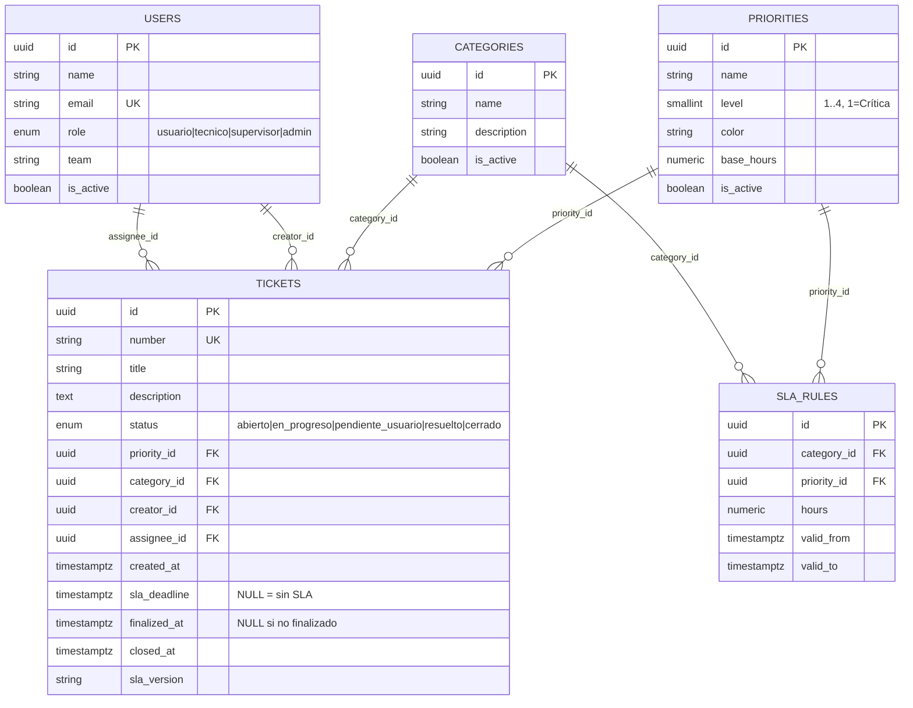

# Modelo de Datos: Cola de Trabajo Priorizada (HU-04)

**Funcionalidad**: `specs/004-prioritized-work-queue`
**Fecha**: 2026-10-29
**Fuente**: modelo base de `specs/001-helpdesk-ticketing/spec.md` + requisitos de `spec.md`
**Tipo de cambio**: lectura sobre el modelo existente y una columna de soporte (`tickets.finalized_at`)

---

## 1. Principios del modelo

1. **El ticket es la unidad de visibilidad**. La cola se construye con `tickets.assignee_id = current_user.id`; no hay tabla de cola materializada ni caché.
2. **El SLA está congelado en el ticket**. `sla_deadline` se fija al crear el ticket y no cambia con configuraciones posteriores (RN-03). Prioridad y categoría también se leen del ticket.
3. **Una sola columna nueva**. `finalized_at` permite el resultado histórico y el orden de finalizados; todo lo demás ya existe en el modelo base.
4. **Sin duplicación de datos derivados**. `remaining_seconds`, `warning_threshold_seconds`, `sla_state` y `sla_outcome` se calculan al responder; no se persisten, para que no queden obsoletos.
5. **Nombres físicos en `snake_case` inglés**, con mapeo explícito a los términos de la spec en español.

---

## 2. Diagrama de entidades



> `SLA_RULES` se muestra por completitud del modelo base, pero esta historia **no la consulta**: el ticket ya guarda su `sla_deadline` y su versión de SLA.

---

## 3. Entidades

### 3.1 `tickets` (tabla existente, ampliada)

| Columna | Tipo | Nulo | Origen | Uso en HU-04 |
|---------|------|------|--------|--------------|
| `id` | `UUID` PK | No | Base | Identificador interno y enlaces. |
| `number` | `VARCHAR(20)` UK | No | Base | Número visible (`TK-000123`) y desempate de orden. |
| `title` | `VARCHAR(200)` | No | Base | Título/resumen de la fila. |
| `description` | `TEXT` | Sí | Base | No se muestra en la cola (solo detalle). |
| `status` | `ticket_status` (enum) | No | Base | Filtro, separación activo/final y etiqueta. |
| `priority_id` | `UUID` FK → `priorities.id` | No | Base | Orden y badge. |
| `category_id` | `UUID` FK → `categories.id` | Sí | Base | Texto de categoría; si es nulo, "Sin categoría". |
| `creator_id` | `UUID` FK → `users.id` | No | Base | No se usa en la cola. |
| `assignee_id` | `UUID` FK → `users.id` | Sí | Base | **Clave de visibilidad**. Si es nulo, el ticket no aparece en ninguna cola. |
| `created_at` | `TIMESTAMPTZ` | No | Base | Inicio del SLA y cálculo de la duración total. |
| `sla_deadline` | `TIMESTAMPTZ` | Sí | Base | Límite congelado. `NULL` = sin SLA. |
| `finalized_at` | `TIMESTAMPTZ` | Sí | **Nueva** | Primer paso a `resuelto`/`cerrado`; resultado histórico y orden final. |
| `closed_at` | `TIMESTAMPTZ` | Sí | Base | Se conserva como dato histórico del cierre; **no** sustituye a `finalized_at`. |
| `sla_version` | `VARCHAR(50)` | Sí | Base | Trazabilidad de la configuración aplicada; no se muestra. |
| `updated_at` | `TIMESTAMPTZ` | No | Base | Solo para backfill de migración y auditoría. |

**Enum `ticket_status`**:

| Valor físico | Etiqueta UI | ¿Final? | ¿En cola por defecto? |
|--------------|-------------|---------|------------------------|
| `abierto` | Abierto | No | Sí |
| `en_progreso` | En progreso | No | Sí |
| `pendiente_usuario` | Pendiente de usuario | No | Sí |
| `resuelto` | Resuelto | Sí | No (solo con filtro) |
| `cerrado` | Cerrado | Sí | No (solo con filtro) |

**Restricciones**:

```sql
-- Una sola fecha de finalización coherente con el estado
ALTER TABLE tickets
  ADD CONSTRAINT ck_tickets_finalized_at
  CHECK (
    (status IN ('resuelto', 'cerrado') AND finalized_at IS NOT NULL)
    OR
    (status NOT IN ('resuelto', 'cerrado') AND finalized_at IS NULL)
  );

-- El SLA, si existe, debe ser posterior a la creación
ALTER TABLE tickets
  ADD CONSTRAINT ck_tickets_sla_deadline_after_created
  CHECK (sla_deadline IS NULL OR sla_deadline > created_at);

-- Un ticket no puede finalizarse antes de crearse
ALTER TABLE tickets
  ADD CONSTRAINT ck_tickets_finalized_after_created
  CHECK (finalized_at IS NULL OR finalized_at >= created_at);

-- Niveles de prioridad válidos
ALTER TABLE priorities
  ADD CONSTRAINT ck_priorities_level CHECK (level BETWEEN 1 AND 4);
```

> La restricción `ck_tickets_finalized_at` exige que los tickets ya finalizados reciban `finalized_at` en la migración. Si el negocio permitiera reabrir un ticket finalizado, la restricción debería relajarse en la HU que introduzca la reapertura; esta historia no la implementa.

**Índices**:

| Índice | Definición | Motivo |
|--------|------------|--------|
| `ix_tickets_assignee_status_deadline` | `(assignee_id, status, sla_deadline)` | Filtro por técnico + estados y orden por deadline. |
| `ix_tickets_assignee_finalized_at` | `(assignee_id, finalized_at DESC)` | Orden de finalizados. |
| `ix_tickets_assignee_priority` | `(assignee_id, priority_id)` | Filtro por prioridad y join. |
| `ix_tickets_number` | `(number)` | Desempate de orden y búsqueda por número. |

Los índices existentes de `assignee_id` o `status` por separado pueden mantenerse; los nuevos son compuestos porque la consulta siempre empieza por el técnico.

**Transición de estado relevante** (implementada en otra HU, solo se documenta):

```text
abierto ──► en_progreso ──► pendiente_usuario ──► en_progreso
   │             │                  │
   └─────────────┴──────────────────┴──► resuelto ──► cerrado

Al entrar por primera vez en resuelto o cerrado:
  finalized_at = COALESCE(finalized_at, now())
```

`finalized_at` no se sobrescribe si el ticket pasa de `resuelto` a `cerrado`. La fecha que cuenta es la del primer estado final (RN-13).

### 3.2 `priorities` (tabla existente)

| Columna | Tipo | Nulo | Uso en HU-04 |
|---------|------|------|--------------|
| `id` | `UUID` PK | No | Join desde `tickets.priority_id`. |
| `name` | `VARCHAR(50)` | No | Etiqueta del badge y filtro. |
| `level` | `SMALLINT` | No | **Clave de orden**: `1` = Crítica, `2` = Alta, `3` = Media, `4` = Baja. |
| `color` | `VARCHAR(7)` | Sí | Se devuelve en la respuesta; el frontend usa un mapa estático por nivel para Tailwind. |
| `base_hours` | `NUMERIC(6,2)` | Sí | No se usa: el deadline ya está en el ticket. |
| `is_active` | `BOOLEAN` | No | Si es `false`, la prioridad sigue mostrándose en tickets existentes y se marca como inactiva en el filtro. |

**Convención de orden**: `ORDER BY priorities.level ASC` (nivel 1 primero). Es una asunción documentada; si el esquema real usara 1 = Baja, se invertiría el término y se actualizarían las pruebas. El contrato expone `level`, no una posición calculada.

### 3.3 `categories` (tabla existente)

| Columna | Tipo | Nulo | Uso en HU-04 |
|---------|------|------|--------------|
| `id` | `UUID` PK | No | Join desde `tickets.category_id`. |
| `name` | `VARCHAR(100)` | No | Texto de la columna Categoría. |
| `description` | `TEXT` | Sí | No se muestra. |
| `is_active` | `BOOLEAN` | No | Si es `false`, se muestra igualmente la categoría almacenada; no se impide listar. |

Si `category_id` es `NULL`, la fila muestra "Sin categoría" y el ticket sigue ordenándose con normalidad. Por eso la consulta de la cola usa `LEFT JOIN categories`; un `INNER JOIN` excluiría tickets sin categoría.

### 3.4 `users` (tabla existente)

| Columna | Tipo | Nulo | Uso en HU-04 |
|---------|------|------|--------------|
| `id` | `UUID` PK | No | `tickets.assignee_id` y `current_user.id`. |
| `name` | `VARCHAR(150)` | No | No se muestra en la tabla; puede usarse en la cabecera. |
| `email` | `VARCHAR(255)` UK | No | Autenticación; no se devuelve en la respuesta de la cola. |
| `role` | `user_role` | No | Debe ser `tecnico` para acceder. |
| `team` | `VARCHAR(100)` | Sí | No se usa. |
| `is_active` | `BOOLEAN` | No | Un usuario inactivo no debería poder autenticarse; lo resuelve la autenticación. |

La respuesta de la cola **no incluye** datos del técnico ni de otros usuarios: solo el `assignee_id` implícito en la consulta. Esto minimiza la exposición de datos personales.

### 3.5 `sla_rules` (tabla existente, no consultada)

Se conserva como fuente de configuración para la HU-08. La HU-04 solo lee `tickets.sla_deadline` y `tickets.created_at`. No se hacen joins a `sla_rules` en tiempo de consulta.

---

## 4. Campos derivados (no persistidos)

Se calculan en `services/work_queue.py` / `utils/sla.py` para cada ticket de la página.

| Campo | Tipo | Fórmula | Regla |
|-------|------|---------|-------|
| `is_final` | `boolean` | `status ∈ {resuelto, cerrado}` | FR-003, RN-13 |
| `sla.started_at` | `timestamptz` | `tickets.created_at` | Inicio del SLA congelado |
| `sla.total_seconds` | `integer` | `floor(sla_deadline - created_at)` | `NULL` si no hay deadline |
| `sla.remaining_seconds` | `integer` | `floor(sla_deadline - now_utc)`, solo en tickets activos | Puede ser negativo; `NULL` si no hay deadline **o si el ticket está finalizado** |
| `sla.warning_threshold_seconds` | `integer` | ver fórmula, solo en tickets activos | `NULL` si no hay deadline **o si el ticket está finalizado**; FR-020 |
| `sla.state` | `enum` | ver tabla de estados | FR-008, FR-018, FR-019 |
| `sla.outcome` | `enum` | `met` / `breached` / `no_sla` | Solo finalizados, FR-034 |
| `sla.breach_delay_seconds` | `integer` | `max(0, finalized_at - deadline)` | Solo finalizados incumplidos |

### 4.1 Umbral de aviso

```text
si total_seconds < 3600:  threshold = floor(total_seconds / 2)
si total_seconds >= 3600: threshold = max(3600, floor(total_seconds / 4))
```

| Duración total | Umbral | Ejemplo de ámbar |
|----------------|--------|------------------|
| 15 min | 7 min 30 s | últimos 7,5 min |
| 30 min | 15 min | últimos 15 min |
| 59 min | 29 min 30 s | últimos 29,5 min |
| 60 min | 60 min | desde la creación (SLA justo de 1 h) |
| 4 h | 60 min | última hora |
| 24 h | 6 h | últimas 6 h |
| 48 h | 12 h | últimas 12 h |

**Nota sobre 60 min**: al usar `>= 60 min` en la rama larga, un SLA de exactamente 60 minutos tiene umbral de 60 minutos y nace en ámbar. Es coherente con la regla acordada (la rama corta es estrictamente `< 60`). Si se quisiera evitar, la condición corta tendría que ser `<= 60`, pero eso contradiría la clarificación aceptada.

### 4.2 Estado de SLA

| `state` | Condición | Texto UI | Estilo |
|---------|-----------|----------|--------|
| `finalized` | `is_final = true` | Resultado histórico | Gris neutro |
| `no_sla` | `sla_deadline IS NULL` | "Sin SLA definido" | Gris neutro |
| `overdue` | `remaining_seconds < 0` | "Vencido hace [tiempo]" | Rojo |
| `at_risk` | `0 <= remaining_seconds <= threshold` | "Próximo a vencer · [tiempo]" o "Vence ahora" si 0 | Ámbar |
| `on_time` | `remaining_seconds > threshold` | "Dentro de plazo · [tiempo]" | Verde suave / neutro |

Prioridad de evaluación: `finalized` → `no_sla` → `overdue` → `at_risk` → `on_time`.

### 4.3 Resultado histórico

| `outcome` | Condición | Texto UI |
|-----------|-----------|----------|
| `met` | `finalized_at <= sla_deadline` | "Dentro de plazo" |
| `breached` | `finalized_at > sla_deadline` | "Incumplido hace [breach_delay]" |
| `no_sla` | `sla_deadline IS NULL` | "Sin SLA definido" |

`breach_delay_seconds` mide cuánto se rebasó el límite al finalizar (`finalized_at - sla_deadline`), no el tiempo transcurrido desde entonces. Así el texto histórico no crece indefinidamente.

---

## 5. Reglas de validación y coherencia

| Regla | Dónde se valida | Error |
|-------|-----------------|-------|
| `status` debe ser uno de los cinco valores | Enum PostgreSQL + Pydantic query | `422` si el filtro es desconocido |
| `priority` debe ser un nivel 1-4 | Pydantic query + `CHECK` | `422` |
| `page >= 1`, `1 <= page_size <= 100` | Pydantic query | `422` |
| `assignee_id` siempre igual al usuario autenticado | Servicio (no parámetro) | Nunca se acepta otro |
| Estado final ⇒ `finalized_at` no nulo | `CHECK` + transición | `500`/error de integridad si se viola |
| Estado no final ⇒ `finalized_at` nulo | `CHECK` | Igual |
| `finalized_at >= created_at` | `CHECK` | Igual |
| `sla_deadline > created_at` si existe | `CHECK` | Igual |
| `finalized_at` no se sobrescribe | Lógica de transición (otra HU) | Se documenta; la prueba de migración lo verifica |
| Ticket sin `assignee_id` no aparece | `WHERE assignee_id = :current_user_id` | No aplica |

**Datos corruptos tolerados en lectura**: si `sla_deadline <= created_at`, el ticket se trata como `no_sla` y se registra una advertencia, en lugar de mostrar una alarma imposible. La restricción de base de datos debería impedir el caso nuevo.

---

## 6. Migración

### 6.1 Pasos

```text
1. ALTER TABLE tickets ADD COLUMN finalized_at TIMESTAMPTZ NULL;
2. UPDATE tickets
     SET finalized_at = COALESCE(closed_at, updated_at)
   WHERE status IN ('resuelto','cerrado')
     AND finalized_at IS NULL;
3. Verificar que no quedan finalizados sin fecha:
     SELECT COUNT(*) FROM tickets
      WHERE status IN ('resuelto','cerrado') AND finalized_at IS NULL;  -- debe ser 0
4. Añadir CHECK ck_tickets_finalized_at.
5. Crear índices compuestos.
6. (Opcional) Comentario de columna:
     COMMENT ON COLUMN tickets.finalized_at IS
     'Primer paso del ticket a Resuelto o Cerrado; no se sobrescribe al cerrar.';
```

### 6.2 Notas

- `closed_at` puede ser `NULL` en tickets `resuelto` que nunca pasaron por `cerrado`; por eso se usa `updated_at` como respaldo. Es una aproximación de migración, no del comportamiento futuro.
- La migración es idempotente en el sentido de que no vuelve a escribir `finalized_at` si ya tiene valor.
- No se reescriben `sla_deadline`, `priority_id` ni `category_id`: los tickets conservan sus valores congelados (RN-03).
- Si la tabla es grande, el `UPDATE` debe hacerse por lotes; con el volumen previsto (decenas de miles) no es necesario en la v1. Se puede añadir `WHERE finalized_at IS NULL` para reejecutar sin coste.

### 6.3 Rollback

```text
DROP INDEX IF EXISTS ix_tickets_assignee_priority;
DROP INDEX IF EXISTS ix_tickets_assignee_finalized_at;
DROP INDEX IF EXISTS ix_tickets_assignee_status_deadline;
ALTER TABLE tickets DROP CONSTRAINT IF EXISTS ck_tickets_finalized_at;
ALTER TABLE tickets DROP COLUMN IF EXISTS finalized_at;
```

El rollback elimina la columna y, con ella, el resultado histórico y el orden de finalizados. Es aceptable porque la funcionalidad no persiste nada más.

---

## 7. Consulta de referencia

La consulta completa y su justificación están en [plan.md](./plan.md#13-ordenación-sql). Resumen del orden:

```sql
ORDER BY
  CASE WHEN t.status IN ('resuelto','cerrado') THEN 1 ELSE 0 END ASC,
  CASE WHEN t.status IN ('resuelto','cerrado') THEN NULL ELSE p.level END ASC NULLS LAST,
  CASE WHEN t.status IN ('resuelto','cerrado') THEN NULL ELSE t.sla_deadline END ASC NULLS LAST,
  CASE WHEN t.status IN ('resuelto','cerrado') THEN t.finalized_at ELSE NULL END DESC NULLS LAST,
  t.number ASC
```

**Ejemplo mental**:

| Ticket | Estado | Prioridad | Deadline | Finalizado | Posición |
|--------|--------|-----------|----------|------------|----------|
| A | En progreso | Crítica (1) | hace 2 h | — | 1 (vencido) |
| B | Abierto | Crítica (1) | en 30 min | — | 2 |
| C | Pendiente usuario | Alta (2) | en 10 min | — | 3 |
| D | Abierto | Alta (2) | sin SLA | — | 4 (sin SLA al final de su prioridad) |
| E | Resuelto | Crítica (1) | hace 1 día | hace 2 h | 5 (primer finalizado) |
| F | Cerrado | Baja (4) | hace 3 días | hace 1 h | 6 (finalizado más reciente) |

Los finalizados E y F van después de todos los activos, aunque E sea Crítica. Entre E y F manda `finalized_at DESC` (F antes que E si F se finalizó más recientemente).

---

## 8. Privacidad y minimización

- La consulta se limita al `current_user.id`; no se acepta un identificador de técnico.
- La respuesta no incluye email, nombre completo ni equipo del técnico ni de otras personas.
- La respuesta no incluye descripción, adjuntos ni comentarios: solo los campos de la fila.
- Las opciones de filtro y el número de resultados se calculan sobre la cola propia, por lo que no revelan volúmenes de otros técnicos.
- No se registran en logs el contenido de los tickets ni datos personales; solo métricas agregadas y errores técnicos.

---

## 9. Resumen de cambios respecto al modelo base

| Elemento | Cambio | Justificación |
|----------|--------|---------------|
| `tickets.finalized_at` | Nueva columna `TIMESTAMPTZ NULL` | FR-034, FR-035, RN-13 |
| `ck_tickets_finalized_at` | Nueva restricción | Coherencia estado/fecha |
| `ck_tickets_finalized_after_created` | Nueva restricción | Integridad temporal |
| `ck_tickets_sla_deadline_after_created` | Nueva restricción | Integridad del SLA |
| `ck_priorities_level` | Nueva restricción | Niveles 1-4 |
| `ix_tickets_assignee_status_deadline` | Nuevo índice | Rendimiento de la consulta |
| `ix_tickets_assignee_finalized_at` | Nuevo índice | Orden de finalizados |
| `ix_tickets_assignee_priority` | Nuevo índice | Filtro por prioridad |
| `ix_tickets_number` | Nuevo índice | Desempate y búsqueda |

No se crean tablas nuevas. No se modifican los datos de tickets existentes salvo el backfill de `finalized_at`.
