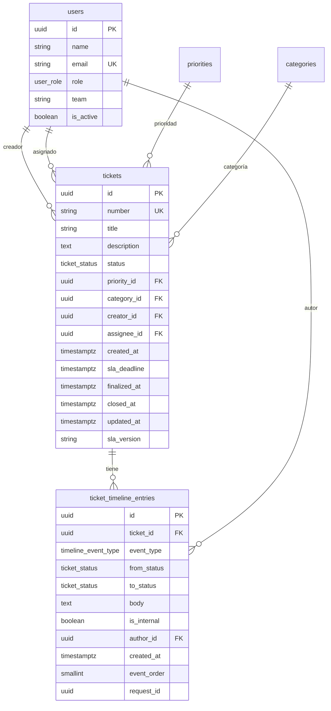

# Data Model: Cambio de estado y documentación de resolución (HU-05)

**Feature**: `005-cambio-estado-resolucion` | **Date**: 2026-11-02 | **Spec**: [spec.md](./spec.md)

Este documento define el modelo de datos de HU-05. **No se modifican las columnas ni las restricciones de las tablas base** (`tickets`, `users`, `priorities`, `categories`). La única estructura nueva es una tabla append-only para la línea temporal, más un enum aditivo.

---

## 1. Diagrama de entidades



---

## 2. Enum nuevo: `TimelineEventType`

Añadir a `backend/app/models/enums.py` (junto a `TicketStatus`, `UserRole`, `SlaState`, `SlaOutcome`):

| Valor | Etiqueta de UI | Uso |
|---|---|---|
| `status_change` | «Cambio de estado» | Cada transición válida |
| `resolution` | «Resolución» | Cada paso a `resuelto` con descripción |
| `internal_comment` | «Comentario interno» | Nota interna del técnico |

```python
class TimelineEventType(str, Enum):
    status_change = "status_change"
    resolution = "resolution"
    internal_comment = "internal_comment"
```

`TicketStatus` **no cambia**: `abierto`, `en_progreso`, `pendiente_usuario`, `resuelto`, `cerrado`. `FINAL_STATUSES` sigue siendo `(resuelto, cerrado)`.

---

## 3. Entidad `TicketTimelineEntry`

**Tabla**: `ticket_timeline_entries`
**Modelo**: `backend/app/models/timeline.py`

| Columna | Tipo | Nulo | Por defecto | Notas |
|---|---|---|---|---|
| `id` | `Uuid` | No | `uuid4()` | PK |
| `ticket_id` | `Uuid` FK `tickets.id` | No | — | `ON DELETE CASCADE` |
| `event_type` | `Enum(TimelineEventType, name="timeline_event_type")` | No | — | `values_callable` para guardar el valor, no el nombre |
| `from_status` | `Enum(TicketStatus, name="ticket_status")` | Sí | — | Solo `status_change` |
| `to_status` | `Enum(TicketStatus, name="ticket_status")` | Sí | — | `status_change` y `resolution` (`resuelto`) |
| `body` | `Text` | Sí | — | Resolución o comentario; nunca en `status_change` |
| `is_internal` | `Boolean` | No | `False` | `True` solo en `internal_comment` |
| `author_id` | `Uuid` FK `users.id` | No | — | Técnico que ejecuta la acción |
| `created_at` | `DateTime(timezone=True)` | No | `utcnow()` | Instante UTC |
| `event_order` | `SmallInteger` | No | `0` | Desempate determinista |
| `request_id` | `Uuid` | No | — | Obligatorio; idempotencia y correlación |

### 3.1. Restricciones `CHECK`

| Nombre | Expresión | Propósito |
|---|---|---|
| `ck_timeline_status_change` | `(event_type <> 'status_change') OR (from_status IS NOT NULL AND to_status IS NOT NULL AND from_status <> to_status AND body IS NULL AND is_internal = false)` | Un cambio de estado siempre tiene origen, destino distinto y no lleva cuerpo |
| `ck_timeline_resolution` | `(event_type <> 'resolution') OR (to_status = 'resuelto' AND body IS NOT NULL AND is_internal = false)` | Una resolución siempre apunta a `resuelto`, tiene texto y es pública |
| `ck_timeline_internal_comment` | `(event_type <> 'internal_comment') OR (from_status IS NULL AND to_status IS NULL AND body IS NOT NULL AND is_internal = true)` | Un comentario interno no cambia estado y es interno |
| `ck_timeline_body_length` | `body IS NULL OR (char_length(body) >= 1 AND char_length(body) <= 5000)` | Límite de 5.000 caracteres |
| `ck_timeline_event_order` | `event_order IN (0, 1)` | Valores previstos |

> En SQLite, `char_length` se traduce a `length` por SQLAlchemy; en PostgreSQL se usa `char_length`. La validación de negocio en el servicio se aplica en ambos motores.

### 3.2. Restricciones `UNIQUE`

| Nombre | Columnas | Propósito |
|---|---|---|
| `uq_timeline_request_event` | `(ticket_id, request_id, event_type)` | Evita duplicados por reintento. La restricción se aplica siempre porque `request_id` es obligatorio. |

### 3.3. Índices

| Nombre | Columnas | Uso |
|---|---|---|
| `ix_timeline_ticket_created` | `(ticket_id, created_at)` | Lectura cronológica por ticket |
| `ix_timeline_ticket_internal` | `(ticket_id, is_internal)` | Filtro de visibilidad |
| `ix_timeline_author` | `(author_id)` | Trazabilidad por autor |

### 3.4. Relaciones

- `TicketTimelineEntry.ticket` → `Ticket` (many-to-one). Se declara solo en el modelo nuevo para no tocar `Ticket`.
- `TicketTimelineEntry.author` → `User` (many-to-one), `lazy="joined"` para evitar N+1 al serializar.

---

## 4. Estados y transiciones

### 4.1. Matriz (RN-02)

| Origen \ Destino | `abierto` | `en_progreso` | `pendiente_usuario` | `resuelto` | `cerrado` |
|---|---|---|---|---|---|
| `abierto` | — (no-op) | ✅ | ❌ | ❌ | ❌ |
| `en_progreso` | ❌ | — (no-op) | ✅ | ✅ + resolución | ❌ |
| `pendiente_usuario` | ❌ | ✅ (manual o automático HU-03) | — (no-op) | ❌ | ❌ |
| `resuelto` | ❌ | ✅ (reapertura) | ❌ | — (no-op) | ✅ |
| `cerrado` | ❌ | ❌ | ❌ | ❌ | — (no-op) |

- `—` significa mismo estado: `200` con `changed = false`, sin escritura y sin entrada.
- Las celdas ❌ devuelven `409 invalid_transition` (o `409 ticket_closed` si el origen es `cerrado`).
- Un ticket `cerrado` no tiene transiciones salientes.

### 4.2. Efectos por transición

| Transición | `tickets.status` | `finalized_at` | `closed_at` | Entradas creadas |
|---|---|---|---|---|
| `abierto → en_progreso` | `en_progreso` | `NULL` | `NULL` | 1 `status_change` |
| `en_progreso → pendiente_usuario` | `pendiente_usuario` | `NULL` | `NULL` | 1 `status_change` |
| `pendiente_usuario → en_progreso` | `en_progreso` | `NULL` | `NULL` | 1 `status_change` |
| `pendiente_usuario → en_progreso` (automática HU-03) | `en_progreso` | `NULL` | `NULL` | 1 `status_change` con autor = usuario creador |
| `en_progreso → resuelto` | `resuelto` | `now` | `NULL` | 1 `status_change` + 1 `resolution` |
| `resuelto → cerrado` | `cerrado` | se conserva | `now` | 1 `status_change` |
| `resuelto → en_progreso` (reapertura) | `en_progreso` | `NULL` | `NULL` | 1 `status_change` |

Cada entrada `status_change` guarda `from_status`, `to_status`, `author_id`, `created_at`, `event_order = 0`, `is_internal = false`, `body = NULL`.
Cada entrada `resolution` guarda `to_status = 'resuelto'`, `body = <texto normalizado>`, `author_id`, `created_at`, `event_order = 1`, `is_internal = false`, `from_status = NULL`.
La transición automática de HU-03 la ejecuta `apply_user_response_transition` dentro de la transacción de HU-03, sin `commit()` ni `rollback()` propios, y registra como autor al usuario creador.

### 4.3. Invariantes

1. `tickets.status` coincide con el `to_status` de la última entrada `status_change` del ticket (RF-033).
2. Toda transición `status_change` con `to_status = 'resuelto'` ejecutada por HU-05 tiene una entrada `resolution` con `body` no vacío y el mismo `request_id` (RF-008/RF-012). Los tickets `resuelto`/`cerrado` anteriores a `0003_ticket_timeline` son legado: se auditan y se excluyen de la aserción; la migración no crea resoluciones sintéticas.
3. `tickets.status IN ('resuelto','cerrado')` ⇔ `tickets.finalized_at IS NOT NULL` (restricción existente).
4. `tickets.closed_at IS NOT NULL` ⇒ `tickets.status = 'cerrado'`.
5. Las entradas de `ticket_timeline_entries` son inmutables: no hay `UPDATE` ni `DELETE` en la aplicación.
6. Una entrada `internal_comment` nunca modifica `tickets.status`.
7. Las resoluciones anteriores se conservan tras una reapertura (no se borran ni se sobrescriben).
8. La línea temporal se ordena por `created_at ASC, event_order ASC, id ASC`. Todas las entradas creadas por un mismo comando comparten el `created_at` de la transacción: `status_change` (`event_order=0`) precede a `resolution` (`event_order=1`). Comandos distintos generan `created_at` distintos (reloj de la base de datos con precisión de microsegundos); `id` solo resuelve el empate residual. Una reapertura no reescribe `event_order` ni `created_at`: crea un nuevo `status_change` y conserva las resoluciones anteriores con su orden original.
9. Los tickets legados sin entradas de HU-05 se reportan, pero no se corrigen automáticamente.

---

## 5. Reglas de validación

### 5.1. Resolución

| Regla | Implementación |
|---|---|
| Obligatoria solo al destino `resuelto` | Servicio: `if target == resuelto and not text: raise ApiError(422, "resolution_required", …)` |
| No vacía tras `strip()` | `text.strip()`; si queda `""`, error |
| 1–5.000 caracteres tras `strip()` | `len(text) > 5000` ⇒ `resolution_too_long` |
| No permitida en otros destinos | Si `target != resuelto` y `resolution` no es `null` ⇒ `resolution_not_allowed`; se valida antes del no-op por mismo estado (RF-034) |
| Inmutable | Solo `INSERT`; sin endpoints de edición/borrado |
| Texto plano | Se guarda y se devuelve como texto; el frontend no usa `v-html` |

### 5.2. Comentario interno

| Regla | Implementación |
|---|---|
| Disponible en cualquier estado, incluido `cerrado` | El servicio no consulta la matriz de estados |
| No vacío tras `strip()` | `comment_required` |
| ≤ 5.000 caracteres tras `strip()` | `comment_too_long` |
| No cambia el estado | No se toca `tickets.status` |
| Autor = técnico asignado | Comprobación de asignación |
| Idempotente | `request_id` + `uq_timeline_request_event` |
| Inmutable | Solo `INSERT` |

### 5.3. Concurrencia

| Regla | Implementación |
|---|---|
| Token de versión | `expected_updated_at` comparado con `tickets.updated_at` |
| Bloqueo de fila | `SELECT id FROM tickets WHERE id = :id FOR UPDATE` y recarga con `session.get(..., populate_existing=True)`; se bloquea solo la fila de `tickets` para no aplicar `FOR UPDATE` sobre los `OUTER JOIN` de relaciones eager |
| Sin escritura parcial | `try/except` con `session.rollback()` |
| Conflicto | `409 stale_ticket` con mensaje de actualización |

### 5.4. Idempotencia de comandos

| Caso | Comportamiento |
|---|---|
| Mismo `request_id`, mismo actor, destino y resolución normalizada | `200` con `changed=false`, `timeline_entries=[]`; no se escribe |
| Mismo `request_id` con otro destino, resolución o actor | `409 request_id_reused`; no se escribe |
| Destino igual al estado actual con un `request_id` nuevo | `200` con `changed=false`; no se escribe ni se consume la clave |
| Comentario interno con `request_id` repetido y mismo `body` normalizado | `200` con `created=false`; no se escribe |
| Comentario interno con `request_id` repetido y `body` o autor distintos | `409 request_id_reused`; no se escribe |

El `request_id` de una transición a `resuelto` se comparte entre la entrada `status_change` y la entrada `resolution`; la unicidad es por `(ticket_id, request_id, event_type)`.

En `internal_comment`, la comparación de idempotencia usa `author_id` y `body.strip()`. Nunca se devuelve `created=false` si el texto o el autor difieren.

---

## 6. DTOs de la API

Los esquemas Pydantic viven en `backend/app/schemas/ticket_workflow.py`.

### 6.1. `TicketStatus` (existente)

```text
abierto | en_progreso | pendiente_usuario | resuelto | cerrado
```

### 6.2. `StatusOption`

```json
{ "value": "en_progreso", "label": "En progreso" }
```

### 6.3. `AuthorRef`

```json
{ "id": "uuid", "name": "Técnica A", "role": "tecnico" }
```

### 6.4. `TimelineEntry`

```json
{
  "id": "uuid",
  "type": "status_change | resolution | internal_comment",
  "from_status": "en_progreso | null",
  "to_status": "resuelto | null",
  "body": "texto | null",
  "is_internal": false,
  "author": { "id": "uuid", "name": "Técnica A", "role": "tecnico" },
  "created_at": "2026-11-02T10:16:00.000000+00:00"
}
```

**Formato de fecha**: los ejemplos usan ISO 8601 UTC con offset `+00:00` y microsegundos (`2026-11-02T10:16:00.000000+00:00`). Un `date-time` UTC puede serializarse como `+00:00` o `Z` según el serializador; el cliente debe aceptar ambos al enviar `expected_updated_at` y el servicio normaliza a UTC antes de comparar.

### 6.5. `TicketWorkflowSnapshot`

```json
{
  "id": "uuid",
  "number": "TCK-000123",
  "title": "No puedo acceder al correo",
  "status": "resuelto",
  "status_label": "Resuelto",
  "assignee_id": "uuid | null",
  "creator_id": "uuid",
  "finalized_at": "2026-11-02T10:16:00.000000+00:00 | null",
  "closed_at": null,
  "updated_at": "2026-11-02T10:16:00.000000+00:00",
  "allowed_transitions": [
    { "value": "en_progreso", "label": "En progreso" },
    { "value": "cerrado", "label": "Cerrado" }
  ]
}
```

### 6.6. `StatusTransitionRequest`

```json
{
  "target_status": "resuelto",
  "resolution": "Se reinició el servicio y se verificó el acceso.",
  "expected_updated_at": "2026-11-02T10:15:30.123456+00:00",
  "request_id": "6f1c2a7e-9b3d-4f4e-8a1b-2c3d4e5f6a7b"
}
```

- `resolution`: `str | None`; **sin** `max_length` en Pydantic (solo valida forma y tipo). La regla 1–5.000 tras `strip()` se valida en el servicio con `resolution_required` / `resolution_too_long`, para no degradar el error a `invalid_request`. Obligatorio solo para `resuelto`.
- `expected_updated_at`: `datetime` obligatorio, se normaliza a UTC.
- `request_id`: `UUID` obligatorio; el frontend genera uno por transición y solo lo reutiliza para reintentos idénticos. Un reintento idéntico devuelve `changed=false` sin escribir; reutilizarlo con otro contenido devuelve `409 request_id_reused`.

### 6.7. `InternalCommentRequest`

```json
{
  "body": "Comprobado el registro del servidor; el error era de credenciales.",
  "request_id": "6f1c2a7e-9b3d-4f4e-8a1b-2c3d4e5f6a7b"
}
```

- `request_id`: UUID obligatorio. Un reintento idéntico (mismo autor y mismo `body.strip()`) devuelve `created=false`; reutilizarlo con otro `body` o autor devuelve `409 request_id_reused` sin escribir. La comprobación se implementa una sola vez en `ticket_workflow.py`; el router solo traduce el resultado a `200`/`201`/`409`.
- Solo el técnico asignado puede crear el comentario: `supervisor` y `admin` reciben `403 forbidden` (aunque puedan leer la timeline interna) y un `tecnico` no asignado recibe `403 not_ticket_assignee`.

### 6.8. `WorkflowResponse`

```json
{
  "ticket": { "...": "TicketWorkflowSnapshot" },
  "can_change_status": true,
  "can_comment_internally": true,
  "can_view_internal": true
}
```

Reglas:

- `can_view_internal = (user.id == ticket.assignee_id) or role in (supervisor, admin)`.
- `can_change_status = (user.id == ticket.assignee_id) and ticket.status != cerrado and allowed_transitions(ticket.status) no vacío`.
- `can_comment_internally = (user.id == ticket.assignee_id)`, incluido `cerrado`.
- `allowed_transitions` es `[]` cuando `can_change_status` es `false`.

Ejemplo de ticket cerrado asignado al técnico:

```json
{
  "ticket": {
    "...": "TicketWorkflowSnapshot",
    "status": "cerrado",
    "allowed_transitions": []
  },
  "can_change_status": false,
  "can_comment_internally": true,
  "can_view_internal": true
}
```

### 6.9. `TimelineResponse`

```json
{
  "items": [ { "...": "TimelineEntry" } ],
  "pagination": {
    "page": 1,
    "page_size": 50,
    "total_items": 12,
    "total_pages": 1,
    "has_next": false,
    "has_previous": false
  }
}
```

---

## 7. Migración `0003_ticket_timeline`

**Fichero**: `backend/alembic/versions/0003_ticket_timeline.py`

```text
revision      = "0003_ticket_timeline"
down_revision = "0002_work_queue"
```

### 7.1. `upgrade()`

1. Crear el tipo `timeline_event_type` en PostgreSQL (si no existe).
2. Crear la tabla `ticket_timeline_entries` con columnas, FKs, `CHECK`s y `UNIQUE`.
3. Crear los índices `ix_timeline_ticket_created`, `ix_timeline_ticket_internal`, `ix_timeline_author`.

No se ejecuta ningún `ALTER TABLE` sobre tablas existentes.

### 7.2. `downgrade()`

1. Eliminar los índices.
2. Eliminar la tabla.
3. Eliminar el tipo `timeline_event_type`.

Es seguro porque la tabla es nueva y no tiene dependencias externas.

### 7.3. Compatibilidad

- **PostgreSQL**: `TIMESTAMPTZ`, `TEXT`, `UUID`, `SMALLINT`, enum nativo.
- **SQLite** (pruebas): tipos genéricos de SQLAlchemy; `TIMESTAMPTZ` se almacena como `DATETIME`; `Enum` se traduce a `VARCHAR + CHECK`; `char_length` se traduce a `length`.
- La migración puede desplegarse antes que el código; el código antiguo ignora la tabla.

---

## 8. Ejemplo de línea temporal

Ticket `TCK-000123`, asignado a `Técnica A`, creador `Usuario B`:

| # | `event_type` | `from_status` | `to_status` | `body` | `is_internal` | `event_order` | Autor |
|---|---|---|---|---|---|---|---|
| 1 | `status_change` | `abierto` | `en_progreso` | `NULL` | `false` | 0 | Técnica A |
| 2 | `internal_comment` | `NULL` | `NULL` | «Revisado el servidor de correo.» | `true` | 0 | Técnica A |
| 3 | `status_change` | `en_progreso` | `resuelto` | `NULL` | `false` | 0 | Técnica A |
| 4 | `resolution` | `NULL` | `resuelto` | «Se reinició el servicio y se verificó el acceso.» | `false` | 1 | Técnica A |
| 5 | `status_change` | `resuelto` | `cerrado` | `NULL` | `false` | 0 | Técnica A |
| 6 | `status_change` | `cerrado` | `en_progreso` | `NULL` | `false` | 0 | Técnica A |

> La fila 6 **no es válida** en esta versión: `cerrado` no se reabre. Se incluye para dejar explícito que la matriz la rechaza. Un ejemplo válido de reapertura sería `resuelto → en_progreso` (fila 4 de la matriz).

Resultado visible:
- **Usuario creador B**: filas 1, 3, 4, 5 (públicas). No ve la fila 2.
- **Técnica A (asignada)**: todas las filas.
- **Supervisor/admin**: todas las filas.
- **Técnico no asignado**: filas públicas (1, 3, 4, 5); no ve la 2.

---

## 9. Retención y borrado

- `ticket_timeline_entries` es append-only. No se define `ON UPDATE` ni `ON DELETE` en la aplicación.
- `ON DELETE CASCADE` en `ticket_id` solo se activa si se elimina el ticket (operación no prevista en v1); evita huérfanos.
- No se incluye trigger de inmutabilidad en la migración para mantener compatibilidad con SQLite en pruebas. Como endurecimiento opcional en PostgreSQL, puede añadirse un trigger `BEFORE UPDATE OR DELETE` que lance una excepción; no es necesario para cumplir la historia porque no existen rutas de escritura distintas de `INSERT`.
