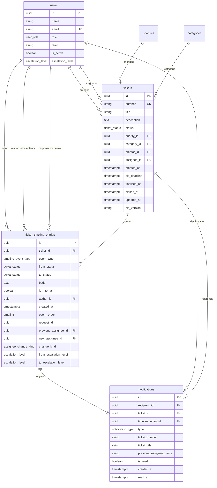

# Data Model: Reasignar o escalar ticket (HU-06)

**Feature**: `006-reasignar-escalar-ticket` | **Date**: 2026-11-10 | **Spec**: [spec.md](./spec.md)

Este documento define el modelo de datos de HU-06. **No se renombran ni se eliminan columnas ni tablas existentes.** La línea temporal de HU-05 se amplía con un tipo de evento y columnas anulables, `users` recibe un atributo de nivel y se añade una tabla de notificaciones. La migración es aditiva hacia delante y su reversión se documenta como destructiva para los datos de esta historia.

---

## 1. Diagrama de entidades



---

## 2. Enums

### 2.1. `EscalationLevel` (nuevo)

`backend/app/models/enums.py`:

```python
class EscalationLevel(str, Enum):
    nivel_1 = "nivel_1"
    nivel_2 = "nivel_2"
    especialista = "especialista"
```

| Valor | Etiqueta de UI | Orden |
|---|---|---|
| `nivel_1` | «Nivel 1» | 1 (base, por defecto) |
| `nivel_2` | «Nivel 2» | 2 |
| `especialista` | «Especialista» | 3 (máximo) |

Catálogo y orden en código, nunca en base de datos:

```python
ESCALATION_LEVEL_ORDER: tuple[EscalationLevel, ...] = (
    EscalationLevel.nivel_1,
    EscalationLevel.nivel_2,
    EscalationLevel.especialista,
)
ESCALATION_LEVEL_LABELS: dict[EscalationLevel, str] = {
    EscalationLevel.nivel_1: "Nivel 1",
    EscalationLevel.nivel_2: "Nivel 2",
    EscalationLevel.especialista: "Especialista",
}
```

### 2.2. `AssigneeChangeKind` (nuevo)

```python
class AssigneeChangeKind(str, Enum):
    reassignment = "reassignment"
    escalation = "escalation"
```

### 2.3. `NotificationType` (nuevo)

```python
class NotificationType(str, Enum):
    ticket_reassigned = "ticket_reassigned"
    ticket_escalated = "ticket_escalated"
```

### 2.4. `TimelineEventType` (ampliado)

```python
class TimelineEventType(str, Enum):
    status_change = "status_change"
    resolution = "resolution"
    internal_comment = "internal_comment"
    assignee_change = "assignee_change"
```

`TicketStatus`, `UserRole`, `SlaState` y `SlaOutcome` no cambian.

---

## 3. Entidad `User` (ampliada)

**Tabla**: `users` | **Modelo**: `backend/app/models/user.py`

| Columna | Tipo | Nulo | Por defecto | Notas |
|---|---|---|---|---|
| `escalation_level` | `Enum(EscalationLevel, name="escalation_level")` | No | `nivel_1` | Nivel de soporte del técnico |

- `server_default` y `default` a `EscalationLevel.nivel_1`.
- Los usuarios existentes quedan en Nivel 1 sin migración de datos manual.
- El nivel solo se usa para candidatos, escalado y DTOs de cambio de responsable; no se añade a la cola de trabajo ni a las entradas históricas de HU-05.
- La administración de niveles queda fuera de alcance (HU06-RN-02).

---

## 4. Entidad `TicketTimelineEntry` (ampliada)

**Tabla**: `ticket_timeline_entries` | **Modelo**: `backend/app/models/timeline.py`

### 4.1. Columnas nuevas

| Columna | Tipo | Nulo | Notas |
|---|---|---|---|
| `previous_assignee_id` | `Uuid` FK `users.id` | Sí | Responsable anterior; solo en `assignee_change` |
| `new_assignee_id` | `Uuid` FK `users.id` | Sí | Responsable nuevo; solo en `assignee_change` |
| `change_kind` | `Enum(AssigneeChangeKind, name="assignee_change_kind")` | Sí | `reassignment` o `escalation` |
| `from_escalation_level` | `Enum(EscalationLevel, name="escalation_level")` | Sí | Nivel del responsable anterior |
| `to_escalation_level` | `Enum(EscalationLevel, name="escalation_level")` | Sí | Nivel destino (igual en reasignación) |

Las cinco columnas son anulables para no tocar las filas existentes de HU-05.

### 4.2. Contenido de una fila `assignee_change`

| Campo | Valor |
|---|---|
| `event_type` | `assignee_change` |
| `body` | Motivo normalizado con `strip()`, 1–5.000 caracteres |
| `is_internal` | `false` (público para el creador) |
| `from_status` / `to_status` | `NULL` (no es una transición de estado) |
| `author_id` / `author` | Técnico que ejecuta la acción (responsable anterior) |
| `previous_assignee_id` | Responsable vigente antes del cambio |
| `new_assignee_id` | Responsable seleccionado |
| `change_kind` | `reassignment` o `escalation` |
| `from_escalation_level` | Nivel del responsable anterior |
| `to_escalation_level` | Nivel del nuevo responsable |
| `event_order` | `0` |
| `request_id` | UUID de idempotencia del comando |
| `created_at` | Instante UTC único para cambio, entrada y notificación |

### 4.3. Restricción `CHECK` nueva

Nombre: `ck_timeline_assignee_change`.

```text
(event_type <> 'assignee_change') OR (
    body IS NOT NULL
    AND is_internal = false
    AND from_status IS NULL
    AND to_status IS NULL
    AND previous_assignee_id IS NOT NULL
    AND new_assignee_id IS NOT NULL
    AND previous_assignee_id <> new_assignee_id
    AND change_kind IS NOT NULL
    AND from_escalation_level IS NOT NULL
    AND to_escalation_level IS NOT NULL
    AND (
        (change_kind = 'reassignment' AND from_escalation_level = to_escalation_level)
        OR
        (change_kind = 'escalation' AND from_escalation_level <> to_escalation_level)
    )
)
```

- La coherencia entre tipo y niveles se garantiza en base de datos.
- La dirección estricta del escalado (`to > from`) se valida en el servicio, para no depender de la comparación de enums en SQLite.
- Las restricciones existentes (`ck_timeline_status_change`, `ck_timeline_resolution`, `ck_timeline_internal_comment`, `ck_timeline_body_length`, `ck_timeline_event_order`, `uq_timeline_request_event`) se conservan y siguen aplicándose solo a su tipo.

### 4.4. Relaciones

Al existir tres claves foráneas a `users` (autor, responsable anterior y responsable nuevo), hay que desambiguar la relación existente:

```python
author: Mapped[User] = relationship(lazy="joined", foreign_keys=[author_id])
previous_assignee: Mapped[User | None] = relationship(
    lazy="joined", foreign_keys=[previous_assignee_id]
)
new_assignee: Mapped[User | None] = relationship(
    lazy="joined", foreign_keys=[new_assignee_id]
)
```

Sin `foreign_keys`, SQLAlchemy no puede determinar a qué FK corresponde `author` y el mapeo falla al arrancar. Las tres relaciones usan `lazy="joined"` para evitar N+1 al serializar la línea temporal.

### 4.5. Índices y restricciones existentes

No se añaden índices nuevos a `ticket_timeline_entries`: las consultas por ticket siguen usando `ix_timeline_ticket_created` y `ix_timeline_ticket_internal`. La unicidad de idempotencia sigue en `uq_timeline_request_event (ticket_id, request_id, event_type)`.

---

## 5. Entidad `Notification` (nueva)

**Tabla**: `notifications` | **Modelo**: `backend/app/models/notification.py`

| Columna | Tipo | Nulo | Por defecto | Notas |
|---|---|---|---|---|
| `id` | `Uuid` | No | `uuid4()` | PK |
| `recipient_id` | `Uuid` FK `users.id` | No | — | Solo el nuevo responsable |
| `ticket_id` | `Uuid` FK `tickets.id` `ON DELETE CASCADE` | No | — | Ticket notificado |
| `timeline_entry_id` | `Uuid` FK `ticket_timeline_entries.id` `ON DELETE CASCADE` | No | — | **UNIQUE**: una notificación por cambio |
| `type` | `Enum(NotificationType, name="notification_type")` | No | — | `ticket_reassigned` / `ticket_escalated` |
| `ticket_number` | `String(20)` | No | — | Snapshot para la campana |
| `ticket_title` | `String(200)` | No | — | Snapshot para la campana |
| `previous_assignee_name` | `String(150)` | No | — | Snapshot para la campana |
| `is_read` | `Boolean` | No | `false` | Contador de no leídas |
| `created_at` | `DateTime(timezone=True)` | No | `utcnow()` | UTC |
| `read_at` | `DateTime(timezone=True)` | Sí | — | Se rellena al marcar leída |

### 5.1. Restricciones

| Nombre | Tipo | Expresión / columnas | Propósito |
|---|---|---|---|
| `ck_notifications_read_at` | `CHECK` | `(is_read = false AND read_at IS NULL) OR (is_read = true AND read_at IS NOT NULL)` | Coherencia entre estado y fecha de lectura |
| `uq_notifications_timeline_entry` | `UNIQUE` | `(timeline_entry_id)` | Una notificación por cambio de responsable |

### 5.2. Índices

| Nombre | Columnas | Uso |
|---|---|---|
| `ix_notifications_recipient_read_created` | `(recipient_id, is_read, created_at)` | Bandeja y contador de no leídas por usuario |
| `ix_notifications_ticket` | `(ticket_id)` | Trazabilidad y limpieza por ticket |

### 5.3. Snapshots

La tabla guarda `ticket_number`, `ticket_title` y `previous_assignee_name` como copias en el momento del cambio:

- La campana no necesita `JOIN` con `tickets` ni con `users`.
- La notificación sigue siendo legible aunque el título del ticket cambie después.
- **No** se guarda el motivo: vive en la línea temporal y se consulta al abrir el ticket.

### 5.4. Inmutabilidad

- La fila se crea una sola vez en la transacción del cambio.
- La única mutación permitida es `is_read = true` y `read_at = now` al marcar como leída.
- No hay endpoint de edición de contenido ni de borrado.
- Si el ticket se elimina, `ON DELETE CASCADE` evita notificaciones huérfanas (operación no prevista en v1).

---

## 6. Invariantes

1. **Responsable ↔ línea temporal**: tras un cambio confirmado, la última entrada `assignee_change` del ticket tiene `new_assignee_id = tickets.assignee_id`, `previous_assignee_id` igual al responsable anterior y `author_id` igual al actor.
2. **Append-only**: no existen rutas de `UPDATE` ni `DELETE` sobre entradas de línea temporal; el motivo y los responsables quedan inmutables.
3. **Atomicidad**: `tickets.assignee_id`, `tickets.updated_at`, la entrada `assignee_change` y la notificación se confirman juntas o no se confirma ninguna.
4. **Una notificación por cambio**: `UNIQUE (timeline_entry_id)` y el replay idempotente evitan duplicados.
5. **Sin efectos colaterales**: `status`, `priority_id`, `category_id`, `sla_deadline`, `sla_version`, `finalized_at` y `closed_at` no cambian.
6. **Visibilidad**: `assignee_change` es público (`is_internal = false`); el creador lo ve con el motivo, igual que los cambios de estado y las resoluciones.
7. **Permisos**: solo el técnico asignado vigente consulta opciones y ejecuta comandos; los roles no técnicos reciben `403 forbidden`, el creador técnico no asignado recibe `forbidden` con precedencia sobre `not_ticket_assignee`, y el técnico anterior no creador recibe `403 not_ticket_assignee` y pierde escritura y visibilidad interna, salvo el replay idéntico de HU06-RN-13, que no escribe. Si el creador es el técnico asignado vigente, opera como responsable.
8. **Idempotencia**: mismo `request_id` + mismo actor + mismo tipo + mismo destino + mismo motivo normalizado ⇒ sin escritura; datos distintos ⇒ `409 request_id_reused`.
9. **Concurrencia**: `expected_updated_at` desactualizado ⇒ `409 stale_ticket` y cero escrituras.
10. **Determinismo**: el escalado produce el mismo responsable ante el mismo estado del sistema (equipo, carga, nombre e `id`).
11. **Monotonía del nivel**: en un escalado, `to_escalation_level` es estrictamente superior a `from_escalation_level`; en una reasignación son iguales.
12. **Nivel del destinatario**: `new_assignee.escalation_level = to_escalation_level` en el momento del cambio.
13. **Autoría**: `author_id = previous_assignee_id` en toda entrada `assignee_change` creada por esta historia.

---

## 7. Reglas de validación

### 7.1. Motivo (HU06-RN-05)

| Regla | Implementación |
|---|---|
| Obligatorio en reasignación y escalado | `reason.strip()` vacío ⇒ `422 reason_required` |
| 1–5.000 caracteres tras `strip()` | `len(reason) > 5000` ⇒ `422 reason_too_long` |
| Solo espacios, tabuladores o saltos | Se considera vacío tras `strip()` |
| Inmutable | Solo `INSERT`; sin endpoints de edición/borrado |
| Texto plano | Se guarda y se renderiza como texto; nunca `v-html` |

### 7.2. Candidatos de reasignación (HU06-RN-03/HU06-RN-14)

| Regla | Implementación |
|---|---|
| Rol técnico y activo | `role = 'tecnico' AND is_active = true` |
| Mismo nivel que el responsable actual | `escalation_level = current.escalation_level` |
| Mismo equipo si el actual tiene equipo | `team = current.team`; si `team IS NULL`, cualquier equipo |
| Excluye al responsable actual | `id <> current.id` |
| Excluye al usuario creador | `id <> ticket.creator_id` |
| Destino inexistente o inactivo | `422 assignee_unavailable` |
| Destino activo con rol, equipo o nivel incorrectos | `422 invalid_reassignment_target` |
| Orden estable | `lower(name) ASC, id ASC` |
| Revalidación en el comando | Se repite la consulta al confirmar |

### 7.3. Escalado (HU06-RN-02/HU06-RN-04)

| Regla | Implementación |
|---|---|
| Existe nivel superior | `higher_escalation_levels(current_level)` vacío ⇒ `409 no_higher_level` (se evalúa primero) |
| Nivel estrictamente superior | `is_higher_level(current_level, target_level)` ⇒ si no, `422 invalid_escalation_level` |
| Hay técnicos activos | Pool del nivel destino vacío (excluido el usuario creador) ⇒ `409 no_technicians_available` |
| Excluye al usuario creador | `id <> ticket.creator_id` |
| Preferencia de equipo | Si el actual tiene equipo, se prefiere ese equipo; si no hay, pool completo |
| Menor carga activa | `COUNT(tickets.id)` con `assignee_id = candidato.id` y estado activo |
| Desempate | `lower(name) ASC, id ASC` |

Estados activos para la carga y para permitir la operación: `abierto`, `en_progreso`, `pendiente_usuario`.

### 7.4. Estados y permisos (HU06-RN-06/HU06-RN-11)

| Regla | Implementación |
|---|---|
| Solo estados activos | `status IN ('abierto', 'en_progreso', 'pendiente_usuario')`; si no, `409 ticket_finalized` |
| Solo el técnico asignado | `ensure_assignee_change_actor(user, ticket)`; creador, supervisor o admin ⇒ `403 forbidden` con precedencia sobre la asignación, aunque el actor tenga rol `tecnico`; técnico no asignado o anterior ⇒ `403 not_ticket_assignee` |
| Identidad desde JWT | `get_current_user`; nunca desde cuerpo, query ni cabeceras manipulables |
| Sin efectos en el flujo | No se modifica `status` ni se crea `status_change` |

### 7.5. Idempotencia (HU06-RN-13)

| Caso | Comportamiento |
|---|---|
| Mismo `request_id`, mismo actor, tipo, destino y motivo normalizado | `200` con `changed=false`, `timeline_entry=null`; no se escribe |
| Replay exacto tras perder la asignación | Se resuelve antes de `ensure_assignee_change_actor`; sigue devolviendo `200 changed=false` sin escribir |
| Solicitud nueva sin asignación vigente | `ensure_assignee_change_actor` ⇒ `403 forbidden` o `403 not_ticket_assignee` |
| Mismo `request_id` con otro actor, tipo, destino o motivo | `409 request_id_reused`; no se escribe |
| Mismo `request_id` en reasignación y escalado | Se consideran tipos distintos: `409 request_id_reused` |
| Replay de escalado | Se compara `target_level`, no la persona seleccionada; no se reselecciona |
| `request_id` nuevo con destino igual al actual | `422 self_reassignment` (no hay no-op válido) |

### 7.6. Concurrencia (HU06-RN-13)

| Regla | Implementación |
|---|---|
| Token de versión | `expected_updated_at` comparado con `tickets.updated_at` normalizado a UTC |
| Bloqueo de fila | `SELECT id FROM tickets WHERE id = :id FOR UPDATE` + recarga con `populate_existing=True` |
| Sin escritura parcial | `try/except` con `session.rollback()` |
| Conflicto | `409 stale_ticket` con mensaje de actualización |
| SQLite | `FOR UPDATE` no aplica; se prueba el token y la concurrencia real en PostgreSQL |

---

## 8. DTOs de la API

Los esquemas Pydantic viven en `backend/app/schemas/assignee_change.py` y `backend/app/schemas/notification.py`. `TicketTimelineEntry` se serializa con `backend/app/services/ticket_timeline.py`.

### 8.1. `AssigneeRef`

```json
{
  "id": "3f2a1b4c-5d6e-4f70-8a9b-0c1d2e3f4a5b",
  "name": "Técnico B",
  "role": "tecnico",
  "team": "Soporte",
  "escalation_level": "nivel_1",
  "escalation_level_label": "Nivel 1"
}
```

`team` es `null` si el usuario no tiene equipo. No se expone correo ni ningún otro dato interno.

### 8.2. `AssigneeChangeOptions`

```json
{
  "ticket_id": "5c2b3d4e-6f7a-4b8c-9d0e-1f2a3b4c5d6e",
  "status": "en_progreso",
  "current_assignee": { "id": "uuid", "name": "Técnico A", "role": "tecnico", "team": "Soporte", "escalation_level": "nivel_1", "escalation_level_label": "Nivel 1" },
  "has_reassignment_candidates": true,
  "has_available_escalation_target": true,
  "reassignment_candidates": [ { "id": "uuid", "name": "Técnico B", "role": "tecnico", "team": "Soporte", "escalation_level": "nivel_1", "escalation_level_label": "Nivel 1" } ],
  "escalation_targets": [
    { "value": "nivel_2", "label": "Nivel 2", "technician_count": 1, "is_available": true },
    { "value": "especialista", "label": "Especialista", "technician_count": 1, "is_available": true }
  ]
}
```

Reglas:

- `has_reassignment_candidates = len(reassignment_candidates) > 0`.
- `has_available_escalation_target = any(target.is_available)`.
- `escalation_targets` solo incluye niveles estrictamente superiores al del responsable actual.
- `technician_count` e `is_available` se calculan con el pool del nivel excluyendo al usuario creador, sin preferencia de equipo, para que la UI sepa si hay alguien que pueda recibir el ticket.
- El endpoint está restringido al técnico asignado; el resto recibe `403`.

### 8.3. `ReassignmentRequest`

```json
{
  "new_assignee_id": "3f2a1b4c-5d6e-4f70-8a9b-0c1d2e3f4a5b",
  "reason": "Estoy de vacaciones; el compañero conoce el caso.",
  "expected_updated_at": "2026-11-10T09:15:30.123456+00:00",
  "request_id": "6f1c2a7e-9b3d-4f4e-8a1b-2c3d4e5f6a7b"
}
```

### 8.4. `EscalationRequest`

```json
{
  "target_level": "nivel_2",
  "reason": "Requiere permisos de administración del servidor.",
  "expected_updated_at": "2026-11-10T09:15:30.123456+00:00",
  "request_id": "0b9e4d6a-1c2f-4a3b-8d7e-5f6a7b8c9d0e"
}
```

- `reason` es `str` sin `max_length` en Pydantic para que la regla de negocio devuelva `reason_required` / `reason_too_long` y no se degrade a `invalid_request`.
- `expected_updated_at` y `request_id` son obligatorios.

### 8.5. `AssigneeChangeResponse`

```json
{
  "changed": true,
  "message": null,
  "ticket": { "...": "TicketWorkflowSnapshot" },
  "previous_assignee": { "...": "AssigneeRef" },
  "new_assignee": { "...": "AssigneeRef" },
  "change_kind": "reassignment",
  "from_escalation_level": "nivel_1",
  "from_escalation_level_label": "Nivel 1",
  "to_escalation_level": "nivel_1",
  "to_escalation_level_label": "Nivel 1",
  "timeline_entry": { "...": "TimelineEntry" }
}
```

- En un replay idempotente: `changed=false`, `timeline_entry=null` y `message` explica el motivo.
- En un cambio real, `timeline_entry` es la entrada creada y el `ticket` refleja el nuevo `assignee_id` y `updated_at`.

### 8.6. `TimelineEntry` (ampliado)

```json
{
  "id": "uuid",
  "type": "assignee_change",
  "from_status": null,
  "to_status": null,
  "body": "Requiere permisos de administración del servidor.",
  "is_internal": false,
  "author": { "id": "uuid", "name": "Técnico B", "role": "tecnico" },
  "created_at": "2026-11-10T09:16:00.000000+00:00",
  "change_kind": "escalation",
  "previous_assignee": { "...": "AssigneeRef" },
  "new_assignee": { "...": "AssigneeRef" },
  "from_escalation_level": "nivel_1",
  "from_escalation_level_label": "Nivel 1",
  "to_escalation_level": "nivel_2",
  "to_escalation_level_label": "Nivel 2"
}
```

Para el resto de tipos, los campos nuevos son `null`. Los clientes antiguos los ignoran.

### 8.7. `Notification`

```json
{
  "id": "uuid",
  "type": "ticket_escalated",
  "ticket_id": "uuid",
  "ticket_number": "TK-000101",
  "ticket_title": "No puedo acceder a la VPN desde casa",
  "previous_assignee_name": "Técnico A",
  "is_read": false,
  "created_at": "2026-11-10T09:16:00.000000+00:00",
  "read_at": null
}
```

### 8.8. `NotificationListResponse`

```json
{
  "items": [ { "...": "Notification" } ],
  "unread_count": 3,
  "pagination": {
    "page": 1,
    "page_size": 20,
    "total_items": 12,
    "total_pages": 1,
    "has_next": false,
    "has_previous": false
  }
}
```

- `unread_count` se calcula sobre **todo** el usuario, no solo sobre la página.
- Orden: `created_at DESC, id DESC`.
- `page_size` admite 1..100 (defecto 20); no reutiliza el `Pagination` de HU-05, que permite hasta 200.
- `unread_only=true` filtra por `is_read = false` sin alterar el contador.

### 8.9. `MarkNotificationReadResponse`

```json
{
  "changed": true,
  "message": null,
  "notification": { "...": "Notification" }
}
```

- Ya leída ⇒ `200 changed=false` sin escritura.
- Notificación inexistente o de otro usuario ⇒ `404 notification_not_found`.

---

## 9. Migración `0004_assignee_changes`

**Fichero**: `backend/alembic/versions/0004_assignee_changes_notifications.py`

```text
revision      = "0004_assignee_changes"
down_revision = "0003_ticket_timeline"
```

### 9.1. `upgrade()`

1. Crear los tipos `escalation_level`, `assignee_change_kind` y `notification_type` en PostgreSQL (`checkfirst=True`).
2. Añadir `users.escalation_level` con `server_default='nivel_1'` y `NOT NULL`.
3. Añadir el valor `assignee_change` a `timeline_event_type` dentro de `op.get_context().autocommit_block()`:

   ```python
   with op.get_context().autocommit_block():
       op.execute(
           "ALTER TYPE timeline_event_type "
           "ADD VALUE IF NOT EXISTS 'assignee_change'"
       )
   ```

   El bloque autocommit confirma el valor antes de usarlo en la restricción de la misma migración.
4. Añadir las cinco columnas anulables a `ticket_timeline_entries`, sus dos FKs y `ck_timeline_assignee_change`.
5. Crear la tabla `notifications` con `ck_notifications_read_at`, `uq_notifications_timeline_entry`, `ix_notifications_recipient_read_created` e `ix_notifications_ticket`.
6. Crear `ix_users_role_active_level_team` sobre `(role, is_active, escalation_level, team)` para la consulta de candidatos.

No se ejecuta ningún `UPDATE` de datos ni se renombra ninguna columna.

### 9.2. `downgrade()`

Operación **destructiva** de los datos de HU-06:

1. Eliminar `ix_notifications_ticket`, `ix_notifications_recipient_read_created` y la tabla `notifications`.
2. Eliminar `ck_timeline_assignee_change`, las FKs y las cinco columnas nuevas de `ticket_timeline_entries`.
3. Borrar las filas con `event_type = 'assignee_change'` (pérdida deliberada; requiere copia de seguridad).
4. Convertir `ticket_timeline_entries.event_type` a texto, eliminar `timeline_event_type` y recrearlo sin `assignee_change`; restaurar la columna al tipo.
5. Eliminar `ix_users_role_active_level_team` y `users.escalation_level`.
6. Eliminar los tipos `notification_type`, `assignee_change_kind` y `escalation_level`.

La recreación del enum es obligatoria porque PostgreSQL no permite quitar un valor con `ALTER TYPE ... DROP VALUE`. El `downgrade()` se valida en PostgreSQL 16 antes de fusionar.

### 9.3. Compatibilidad

- **PostgreSQL**: `TIMESTAMPTZ`, `TEXT`, `UUID`, `SMALLINT`, enums nativos.
- **SQLite** (pruebas): tipos genéricos de SQLAlchemy; los enums se traducen a `VARCHAR + CHECK`; `Base.metadata.create_all()` genera el esquema equivalente y la migración no se ejecuta.
- La migración puede desplegarse antes que el código: el código antiguo ignora las columnas anulables, el nuevo valor del enum y la tabla nueva.
- Los clientes antiguos ignoran los campos aditivos de `workflow` y `timeline`.

### 9.4. Datos de desarrollo (`backend/scripts/seed_dev.py`)

Para que el quickstart sea reproducible, el seed asigna niveles y añade escenarios:

| Usuario | Rol | Equipo | Nivel |
|---|---|---|---|
| Técnico A | `tecnico` | Soporte | `nivel_1` |
| Técnico B | `tecnico` | Soporte | `nivel_1` |
| Técnico E | `tecnico` | Soporte | `nivel_1` |
| Técnico F | `tecnico` | Infraestructura | `nivel_1` |
| Técnico C | `tecnico` | Soporte | `nivel_2` |
| Técnico D | `tecnico` | Soporte | `especialista` |
| Supervisor | `supervisor` | Soporte | `nivel_1` (sin uso en HU-06) |
| Solicitante | `usuario` | — | `nivel_1` (sin uso en HU-06) |

Además, el ticket `TK-000102` se crea con `creator = Técnico B` y `assignee = Técnico A` para poder comprobar que un creador con rol técnico nunca aparece como candidato. Los tickets de A siguen asignados a A; C, D, E y F no tienen carga activa salvo que el escenario lo indique.

---

## 10. Ejemplo de línea temporal y notificaciones

Ticket `TK-000101`, creador `Técnico A` y responsable inicial `Técnico A`:

| # | `event_type` | `body` | `previous_assignee` | `new_assignee` | `change_kind` | Niveles | `is_internal` | Autor |
|---|---|---|---|---|---|---|---|---|
| 1 | `status_change` | `NULL` | — | — | — | — | `false` | Técnico A |
| 2 | `assignee_change` | «Estoy de vacaciones; el compañero conoce el caso.» | Técnico A | Técnico E | `reassignment` | `nivel_1 → nivel_1` | `false` | Técnico A |
| 3 | `assignee_change` | «Requiere permisos de administración del servidor.» | Técnico E | Técnico C | `escalation` | `nivel_1 → nivel_2` | `false` | Técnico E |
| 4 | `internal_comment` | «Revisado el registro del servidor.» | — | — | — | — | `true` | Técnico C |
| 5 | `assignee_change` | «El caso necesita al especialista de base de datos.» | Técnico C | Técnico D | `escalation` | `nivel_2 → especialista` | `false` | Técnico C |

Notificaciones:

| # | `recipient_id` | `type` | `ticket_number` | `previous_assignee_name` | `is_read` |
|---|---|---|---|---|---|
| 2 | Técnico E | `ticket_reassigned` | `TK-000101` | Técnico A | `false` |
| 3 | Técnico C | `ticket_escalated` | `TK-000101` | Técnico E | `true` |
| 5 | Técnico D | `ticket_escalated` | `TK-000101` | Técnico C | `false` |

Resultado visible:

- **Técnico A (creador y responsable anterior)**: ve las filas 1, 2, 3 y 5; no ve la 4. No puede escribir tras el primer traspaso.
- **Técnico E (responsable anterior)**: ve las filas 1, 2, 3 y 5; no ve la 4 tras el escalado.
- **Técnico C (responsable anterior)**: ve todas las filas mientras fue responsable; tras el escalado pierde la 4.
- **Técnico D (responsable actual)**: ve todas las filas, incluida la 4.
- **Supervisor/admin**: ven todas las filas.
- **Técnico no asignado**: ve las filas públicas (1, 2, 3 y 5); no ve la 4.

---

## 11. Retención y borrado

- `ticket_timeline_entries` sigue siendo append-only. No se define `ON UPDATE` ni `ON DELETE` en la aplicación.
- `notifications` se conserva hasta que el destinatario la marca como leída; no se borra al leer.
- `notifications.timeline_entry_id` y `notifications.ticket_id` usan `ON DELETE CASCADE` solo para evitar huérfanos si se elimina el ticket o la entrada (operaciones no previstas en v1).
- No se añade un trigger de inmutabilidad para mantener compatibilidad con SQLite en pruebas. Como endurecimiento opcional en PostgreSQL, puede añadirse un `BEFORE UPDATE OR DELETE` sobre `ticket_timeline_entries`; no es necesario para cumplir la historia porque no existen rutas de escritura distintas de `INSERT`.
