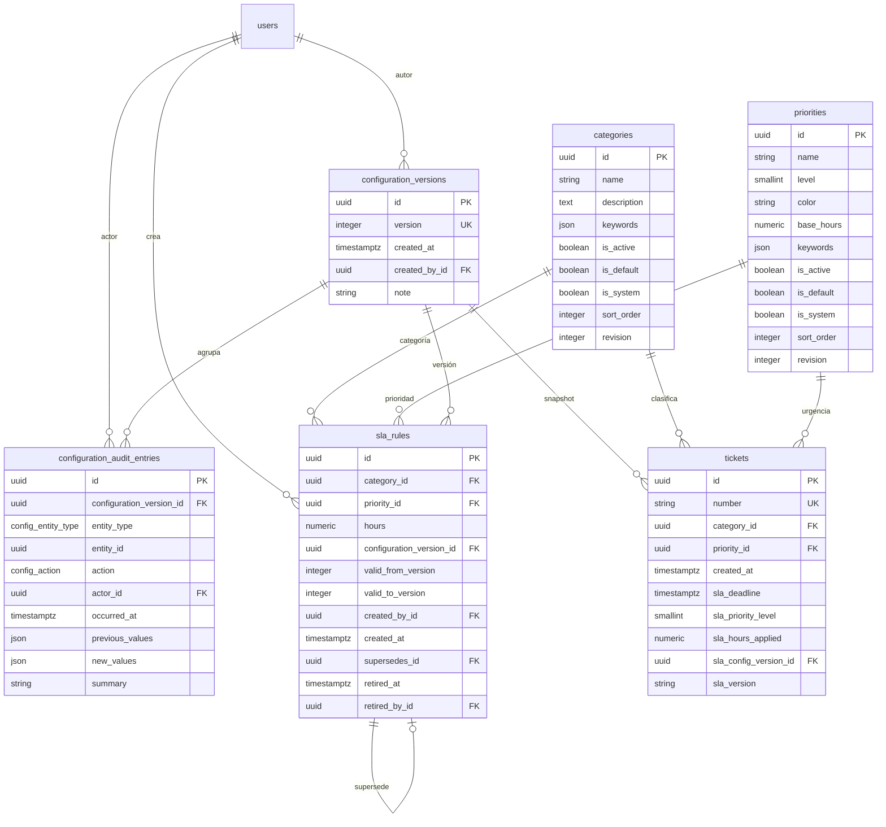

# Data Model: Configuración de categorías, prioridades y plazos (HU-08)

**Feature**: `008-configuracion-plazos-sla` | **Date**: 2026-11-15 | **Spec**: [spec.md](./spec.md)

Este documento define el modelo de datos de HU-08. Se mantienen las tablas base y se añaden estructuras aditivas para versionar la configuración, congelar el SLA en los tickets y auditar los cambios.

---

## 1. Diagrama de entidades



---

## 2. Enums nuevos

Añadir a `backend/app/models/enums.py`, junto a los existentes:

```python
class ConfigEntityType(str, Enum):
    category = "category"
    priority = "priority"
    sla_rule = "sla_rule"


class ConfigAction(str, Enum):
    create = "create"
    update = "update"
    deactivate = "deactivate"
    reactivate = "reactivate"
    delete = "delete"
    set_default = "set_default"
    rule_upsert = "rule_upsert"
    rule_retire = "rule_retire"
```

Se persisten con `values_callable` para guardar el valor, igual que `TicketStatus` y `TimelineEventType`.

---

## 3. Entidad `ConfigurationVersion`

**Tabla**: `configuration_versions`
**Modelo**: `backend/app/models/configuration.py`

| Columna | Tipo | Nulo | Por defecto | Notas |
|---|---|---|---|---|
| `id` | `Uuid` | No | `uuid4()` | PK |
| `version` | `Integer` | No | — | Único, positivo y monótono |
| `created_at` | `DateTime(timezone=True)` | No | `utcnow()` | UTC |
| `created_by_id` | `Uuid` FK `users.id` | Sí | — | `NULL` solo en la línea base de la migración |
| `note` | `String(500)` | Sí | — | Descripción breve del cambio o lote |

### 3.1. Restricciones

| Nombre | Expresión | Propósito |
|---|---|---|
| `uq_configuration_versions_version` | `UNIQUE (version)` | Una versión por número |
| `ck_configuration_versions_version_positive` | `version > 0` | Números válidos |

### 3.2. Índices

- `ix_configuration_versions_created_at` sobre `created_at` para ordenar el histórico.

La línea base se inserta en la migración `0006` con `version = 1`, `created_by_id = NULL` y `note = 'Línea base de configuración'`. El fixture `backend/tests/conftest.py` replica esa fila al crear el esquema desde los modelos; el servicio no crea versiones implícitas durante la creación de tickets.

---

## 4. Entidad `SlaRule`

**Tabla**: `sla_rules`
**Modelo**: `backend/app/models/configuration.py`

Cada fila es una versión inmutable de una regla para una combinación. Las filas no se actualizan salvo para fijar `valid_to_version`, `retired_at` y `retired_by_id` en la retirada o sustitución.

| Columna | Tipo | Nulo | Por defecto | Notas |
|---|---|---|---|---|
| `id` | `Uuid` | No | `uuid4()` | PK de la versión de la regla |
| `category_id` | `Uuid` FK `categories.id` | No | — | Combinación |
| `priority_id` | `Uuid` FK `priorities.id` | No | — | Combinación |
| `hours` | `Numeric(6,2)` | No | — | Plazo en horas, positivo, precisión de minutos |
| `configuration_version_id` | `Uuid` FK `configuration_versions.id` | No | — | Versión que creó la fila |
| `valid_from_version` | `Integer` | No | — | Copia de `ConfigurationVersion.version` |
| `valid_to_version` | `Integer` | Sí | — | Versión que la sustituye o retira; `NULL` = vigente |
| `created_by_id` | `Uuid` FK `users.id` | No | — | Administrador autor |
| `created_at` | `DateTime(timezone=True)` | No | `utcnow()` | UTC |
| `supersedes_id` | `Uuid` FK `sla_rules.id` | Sí | — | Regla anterior de la misma combinación |
| `retired_at` | `DateTime(timezone=True)` | Sí | — | Retirada explícita sin sustituto |
| `retired_by_id` | `Uuid` FK `users.id` | Sí | — | Autor de la retirada |

### 4.1. Restricciones `CHECK`

| Nombre | Expresión | Propósito |
|---|---|---|
| `ck_sla_rules_hours_positive` | `hours > 0` | Plazo válido |
| `ck_sla_rules_valid_range` | `valid_to_version IS NULL OR valid_to_version > valid_from_version` | Rango coherente |
| `ck_sla_rules_retired_range` | `retired_at IS NULL OR valid_to_version IS NOT NULL` | Una retirada cierra la vigencia |

### 4.2. Restricciones `UNIQUE`

| Nombre | Columnas | Propósito |
|---|---|---|
| `uq_sla_rules_version_combination` | `(category_id, priority_id, valid_from_version)` | Una sola fila por combinación y versión |
| `uq_sla_rules_current_combination` | `(category_id, priority_id)` parcial `WHERE valid_to_version IS NULL` | Como máximo una regla vigente por combinación |

El índice parcial se declara con `postgresql_where` y `sqlite_where` sobre `valid_to_version.is_(None)`. El servicio valida antes de escribir para devolver `409 duplicate_sla_rule` con un mensaje comprensible.

### 4.3. Índices

| Nombre | Columnas | Uso |
|---|---|---|
| `ix_sla_rules_category_priority` | `(category_id, priority_id)` | Matriz y resolución de una combinación |
| `ix_sla_rules_current` | `(category_id, priority_id, valid_to_version)` | Lectura de reglas vigentes |
| `ix_sla_rules_version` | `(configuration_version_id)` | Reconstrucción de una versión |
| `ix_sla_rules_created_at` | `(created_at)` | Histórico y retención |

### 4.4. Reconstrucción histórica

Para una versión `N`, las reglas vigentes son:

```sql
SELECT *
FROM sla_rules
WHERE valid_from_version <= :n
  AND (valid_to_version IS NULL OR valid_to_version > :n);
```

El ticket no necesita esta consulta para operar, porque guarda su snapshot; se usa para auditoría y para explicar la configuración aplicada.

---

## 5. Entidad `ConfigurationAuditEntry`

**Tabla**: `configuration_audit_entries`
**Modelo**: `backend/app/models/configuration.py`

| Columna | Tipo | Nulo | Por defecto | Notas |
|---|---|---|---|---|
| `id` | `Uuid` | No | `uuid4()` | PK |
| `configuration_version_id` | `Uuid` FK `configuration_versions.id` | No | — | Versión del cambio |
| `entity_type` | `Enum(ConfigEntityType)` | No | — | `category`, `priority` o `sla_rule` |
| `entity_id` | `Uuid` | No | — | Identificador de la entidad afectada |
| `action` | `Enum(ConfigAction)` | No | — | Acción realizada |
| `actor_id` | `Uuid` FK `users.id` | No | — | Administrador que ejecutó la acción |
| `occurred_at` | `DateTime(timezone=True)` | No | `utcnow()` | UTC |
| `previous_values` | `JSON` | Sí | — | Valores antes del cambio |
| `new_values` | `JSON` | Sí | — | Valores después del cambio |
| `summary` | `String(500)` | No | — | Texto legible en español |

### 5.1. Invariantes

1. La tabla es append-only: no hay `UPDATE` ni `DELETE` en la aplicación.
2. `previous_values` es `NULL` en altas; `new_values` es `NULL` en borrados.
3. Los valores JSON son serializables y conservan la información necesaria para explicar el cambio: nombres, descripciones, `keywords`, `level`, `color`, `base_hours`, `is_active`, `is_default`, `sort_order`, horas, versión y regla sustituida.
4. Las fechas se guardan como ISO 8601 UTC y los decimales como cadena para no perder precisión.
5. Cada entrada comparte `configuration_version_id` con el resto de cambios de la misma transacción.

### 5.2. Índices

| Nombre | Columnas | Uso |
|---|---|---|
| `ix_config_audit_occurred_at` | `(occurred_at)` | Filtro por rango y paginación |
| `ix_config_audit_entity` | `(entity_type, entity_id)` | Historia de una entidad |
| `ix_config_audit_version` | `(configuration_version_id)` | Cambios de una versión |
| `ix_config_audit_actor` | `(actor_id)` | Trazabilidad por autor |

---

## 6. Cambios aditivos en tablas existentes

### 6.1. `categories`

| Columna | Tipo | Nulo | Por defecto | Notas |
|---|---|---|---|---|
| `revision` | `Integer` | No | `1` | Bloqueo optimista |

### 6.2. `priorities`

| Columna | Tipo | Nulo | Por defecto | Notas |
|---|---|---|---|---|
| `revision` | `Integer` | No | `1` | Bloqueo optimista |

### 6.3. `tickets`

| Columna | Tipo | Nulo | Notas |
|---|---|---|---|
| `sla_priority_level` | `SmallInteger` | Sí | Nivel congelado en la creación |
| `sla_hours_applied` | `Numeric(6,2)` | Sí | Horas aplicadas en la creación |
| `sla_config_version_id` | `Uuid` FK `configuration_versions.id` | Sí | Versión aplicada |

Restricciones nuevas:

| Nombre | Expresión |
|---|---|
| `ck_tickets_sla_priority_level` | `sla_priority_level IS NULL OR sla_priority_level BETWEEN 1 AND 4` |
| `ck_tickets_sla_hours_positive` | `sla_hours_applied IS NULL OR sla_hours_applied > 0` |

Índice nuevo:

- `ix_tickets_sla_config_version` sobre `sla_config_version_id`.

`tickets.sla_deadline` y `tickets.sla_version` no cambian. `sla_version` se rellena con `v<version>` en los tickets nuevos; los existentes conservan su valor.

### 6.4. Compatibilidad con tickets anteriores

La migración:

1. Añade las columnas como anulables.
2. Rellena `sla_priority_level` desde `priorities.level` para todos los tickets existentes.
3. Rellena `sla_hours_applied` desde `sla_deadline - created_at` cuando ambas existen, redondeando a dos decimales.
4. Deja `sla_config_version_id = NULL` en los tickets anteriores, porque no existe una versión histórica fiable.
5. No modifica `sla_deadline`, `sla_version`, estados, `finalized_at` ni `closed_at`.

Las lecturas usan `COALESCE` cuando el snapshot puede ser nulo, de modo que los tickets legados siguen funcionando. Estos tickets conservan su plazo y nivel, pero `sla_config_version_id = NULL`; el escenario de «conservar la versión anterior» aplica a tickets creados desde la línea base `v1`.

---

## 7. Reglas de validación

### 7.1. Categorías

| Regla | Implementación |
|---|---|
| Nombre obligatorio y 1–100 caracteres | Pydantic + servicio |
| Unicidad ignorando mayúsculas/minúsculas y espacios | Normalización `lower(trim(name))` + índice único |
| Descripción opcional ≤ 2.000 caracteres | Pydantic |
| `keywords` ≤ 50 elementos de 1–50 caracteres, sin duplicados normalizados | Pydantic + servicio |
| `sort_order` 0–9.999 | Pydantic |
| `is_system` no editable | Servicio: `409 system_catalog_item` |
| Default único entre no-sistema | Servicio + índice único parcial |
| No desactivar la última activa no-sistema | Servicio: `409 last_active_catalog_item` |
| No borrar si hay tickets o reglas | Servicio: `409 catalog_in_use` |

### 7.2. Prioridades

| Regla | Implementación |
|---|---|
| Nombre obligatorio y 1–50 caracteres | Pydantic + servicio |
| Unicidad normalizada | Normalización + índice único |
| `level` entero 1–4 y único entre no-sistema **activas** | Pydantic + servicio + índice único parcial `uq_priorities_level_active_non_system` sobre `level` `WHERE is_active AND NOT is_system` |
| `color` `#RRGGBB` opcional | Pydantic con patrón |
| `base_hours` decimal positivo, ≤ 9999.99, precisión de minutos | Pydantic + `Numeric(6,2)` |
| `keywords`, `sort_order`, default, desactivación y borrado | Igual que categorías |
| Una prioridad activa aplicable siempre | Default + última activa |
| Una inactiva libera su nivel; al reactivarla se valida de nuevo | Servicio: `409 duplicate_priority_level` |
| La prioridad de sistema no reserva nivel ni entra en el catálogo operativo | Filtro `NOT is_system` |

### 7.3. Reglas SLA

| Regla | Implementación |
|---|---|
| Horas positivas, ≤ 9999.99 | Pydantic + servicio + `CHECK` |
| Una regla vigente por combinación | Servicio + índice único parcial |
| Categoría y prioridad existentes y activas para crear/editar | Servicio: `422 inactive_catalog_item` |
| Una regla existente se modifica creando otra fila | Servicio: retira la anterior con `valid_to_version = N` |
| Retirar una regla no afecta a tickets | No se tocan `tickets` |
| Lote atómico | Una transacción y una versión; si falla una celda, `rollback` |
| Sin fechas pasadas ni futuras | No se aceptan campos de fecha de aplicación; siempre es la versión actual |

### 7.4. Concurrencia

| Regla | Implementación |
|---|---|
| Categoría/prioridad desactualizada | `expected_revision` ≠ `revision` ⇒ `409 stale_configuration` |
| Regla desactualizada | `expected_rule_id` ≠ regla vigente ⇒ `409 stale_configuration` |
| Escritores serializados | `SELECT ... FOR UPDATE` sobre la versión vigente |
| Ticket coherente | `SELECT ... FOR SHARE` sobre la versión vigente antes de leer reglas |
| Sin escritura parcial | `try/except` con `rollback` completo |

---

## 8. DTOs de la API

Los esquemas Pydantic viven en `backend/app/schemas/configuration.py`. Los tipos TypeScript espejo viven en `frontend/src/types/adminConfiguration.ts`.

### 8.1. `ConfigurationVersionRef`

```json
{
  "id": "uuid",
  "version": 7,
  "created_at": "2026-11-15T10:30:00Z",
  "created_by": { "id": "uuid", "name": "Admin", "email": "admin@example.com" }
}
```

`created_by` es `null` en la línea base.

### 8.2. `CategoryAdmin`

```json
{
  "id": "uuid",
  "name": "Red",
  "description": "Conectividad y acceso remoto.",
  "keywords": ["vpn", "wifi", "red"],
  "is_active": true,
  "is_default": false,
  "is_system": false,
  "sort_order": 10,
  "revision": 3,
  "ticket_count": 12,
  "rule_count": 2,
  "can_delete": false
}
```

### 8.3. `PriorityAdmin`

```json
{
  "id": "uuid",
  "name": "Alta",
  "level": 2,
  "color": "#ea580c",
  "base_hours": "8.00",
  "keywords": ["importante", "bloqueado"],
  "is_active": true,
  "is_default": false,
  "is_system": false,
  "sort_order": 20,
  "revision": 1,
  "ticket_count": 20,
  "rule_count": 3,
  "can_delete": false
}
```

Los decimales se transportan como cadena para conservar la precisión.

### 8.4. `CategoryCreateRequest` / `PriorityCreateRequest`

```json
{
  "name": "Red",
  "description": "Conectividad y acceso remoto.",
  "keywords": ["vpn", "wifi"],
  "sort_order": 10,
  "is_default": false
}
```

Prioridad añade `level`, `color` y `base_hours`. `is_system` no se acepta.

### 8.5. `CategoryUpdateRequest` / `PriorityUpdateRequest`

```json
{
  "expected_revision": 3,
  "name": "Red y comunicaciones",
  "description": "Conectividad, VPN y acceso remoto.",
  "keywords": ["vpn", "wifi", "dns"],
  "sort_order": 10,
  "is_active": true,
  "is_default": false,
  "replacement_default_id": null
}
```

Todos los campos salvo `expected_revision` son opcionales. `replacement_default_id` es obligatorio cuando `is_active = false` y la entidad es la default.

### 8.6. `DeleteRequest`

```json
{ "expected_revision": 3 }
```

### 8.7. `SlaRuleAdmin`

```json
{
  "id": "uuid",
  "category": { "id": "uuid", "name": "Red", "is_active": true },
  "priority": { "id": "uuid", "name": "Alta", "level": 2, "is_active": true },
  "hours": "6.00",
  "valid_from_version": 7,
  "configuration_version_id": "uuid",
  "created_at": "2026-11-15T10:30:00Z",
  "created_by": { "id": "uuid", "name": "Admin", "email": "admin@example.com" }
}
```

### 8.8. `SlaMatrixResponse`

```json
{
  "configuration_version": { "id": "uuid", "version": 7, "created_at": "..." },
  "items": [SlaRuleAdmin],
  "combinations": {
    "categories": [{ "id": "uuid", "name": "Red", "is_active": true }],
    "priorities": [{ "id": "uuid", "name": "Alta", "level": 2, "color": "#ea580c", "base_hours": "8.00", "is_active": true }]
  }
}
```

### 8.9. `SlaBatchRequest`

```json
{
  "changes": [
    {
      "operation": "upsert",
      "category_id": "uuid",
      "priority_id": "uuid",
      "hours": "6.00",
      "expected_rule_id": null
    },
    {
      "operation": "upsert",
      "category_id": "uuid",
      "priority_id": "uuid",
      "hours": "12.00",
      "expected_rule_id": "uuid"
    },
    {
      "operation": "retire",
      "rule_id": "uuid",
      "expected_rule_id": "uuid"
    }
  ]
}
```

Validaciones:

- `changes` no vacío y máximo 20 operaciones por lote.
- `upsert`: `hours > 0`, `expected_rule_id` nulo si no hay regla vigente, o igual al `id` vigente.
- `retire`: `expected_rule_id == rule_id`.
- Sin operaciones duplicadas para la misma combinación en el mismo lote.

### 8.10. `SlaBatchResponse`

```json
{
  "configuration_version": { "id": "uuid", "version": 8, "created_at": "..." },
  "items": [SlaRuleAdmin]
}
```

### 8.11. `ConfigHistoryEntry`

```json
{
  "id": "uuid",
  "configuration_version": { "id": "uuid", "version": 8, "created_at": "..." },
  "entity_type": "sla_rule",
  "entity_id": "uuid",
  "action": "rule_upsert",
  "actor": { "id": "uuid", "name": "Admin", "email": "admin@example.com" },
  "occurred_at": "2026-11-15T10:30:00Z",
  "previous_values": { "hours": "6.00" },
  "new_values": { "hours": "12.00" },
  "summary": "Plazo de Red × Alta actualizado de 6 a 12 horas"
}
```

### 8.12. `ConfigHistoryResponse`

```json
{
  "items": [ConfigHistoryEntry],
  "pagination": {
    "page": 1,
    "page_size": 25,
    "total_items": 120,
    "total_pages": 5,
    "has_next": true,
    "has_previous": false
  }
}
```

---

## 9. Migración `0006_sla_configuration`

**Revisión**: `0006_sla_configuration`
**Down revision**: `0005_ticket_information`

### 9.1. `upgrade()`

1. Crear `configuration_versions`.
2. Insertar la línea base `version = 1` con `created_by_id = NULL`.
3. Crear `sla_rules` con sus `CHECK`, `UNIQUE`, FK e índices.
4. Crear `configuration_audit_entries` con sus enums e índices.
5. Añadir `revision` a `categories` y `priorities` con `server_default='1'`.
6. Añadir las columnas de snapshot a `tickets` como anulables.
7. Rellenar `sla_priority_level` desde `priorities.level`.
8. Rellenar `sla_hours_applied` desde `sla_deadline - created_at` cuando sea posible.
9. Crear el índice `ix_tickets_sla_config_version`.
10. Crear los índices únicos parciales de nombres normalizados, nivel de prioridad no-sistema activo y default único.

Antes de crear los índices únicos, la migración comprueba duplicados preexistentes. Si existen, aborta con un mensaje claro que indica la entidad y los valores duplicados, en lugar de modificarlos silenciosamente.

### 9.2. `downgrade()`

1. Eliminar los índices únicos parciales.
2. Eliminar `ix_tickets_sla_config_version`.
3. Eliminar las columnas `sla_priority_level`, `sla_hours_applied` y `sla_config_version_id` de `tickets`.
4. Eliminar `revision` de `categories` y `priorities`.
5. Eliminar `configuration_audit_entries`.
6. Eliminar `sla_rules`.
7. Eliminar `configuration_versions`.

Los enums nuevos (`config_entity_type`, `config_action`) se crean explícitamente con `create_type=False` en las tablas y se eliminan al final del `downgrade()`, siguiendo el patrón de `0001` y `0003`.

### 9.3. Compatibilidad

- La migración no modifica `sla_deadline`, `sla_version`, estados, `finalized_at` ni `closed_at`.
- Los tickets legados quedan con `sla_config_version_id = NULL`; la aplicación los trata con `COALESCE`.
- La línea base permite crear tickets inmediatamente después de migrar, sin esperar a que un administrador configure la matriz.

---

## 10. Ejemplo de evolución

| Versión | Acción | Efecto en reglas | Ticket creado después |
|---|---|---|---|
| 1 | Línea base | Sin reglas; se usa `priority.base_hours` | Snapshot v1, plazo base |
| 2 | Regla Red × Alta = 6 h | Nueva fila vigente | Snapshot v2, 6 h |
| 3 | Cambio Red × Alta = 12 h | Fila v2 cerrada; nueva fila v3 | Snapshot v3, 12 h |
| 4 | Retirada Red × Alta | Fila v3 cerrada con `retired_at` | Snapshot v4, plazo base de Alta |
| 5 | Cambio `base_hours` de Alta a 10 h | Sin regla para la combinación | Snapshot v5, 10 h |

Los tickets creados en las versiones 1–4 conservan exactamente sus horas, su límite y su nivel de urgencia.

---

## 11. Retención y borrado

- `configuration_versions`, `sla_rules` y `configuration_audit_entries` no se borran desde la aplicación.
- El borrado de una categoría o prioridad solo elimina la fila del catálogo cuando no tiene tickets ni reglas; las reglas históricas siempre conservan su FK y, por tanto, bloquean el borrado.
- No se implementa purga automática en esta historia.
